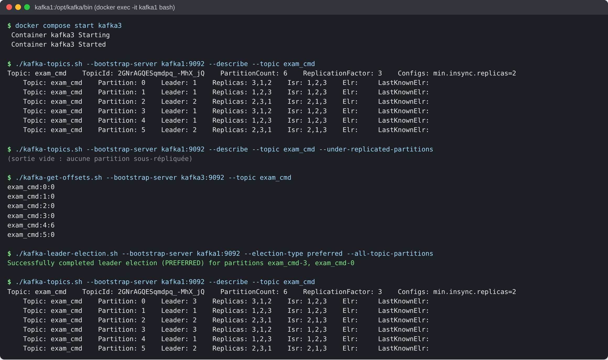
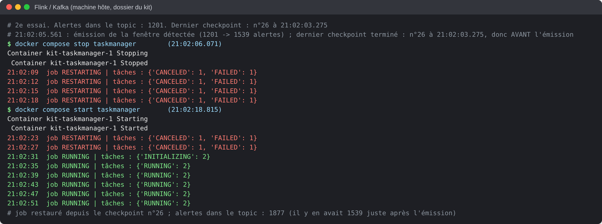
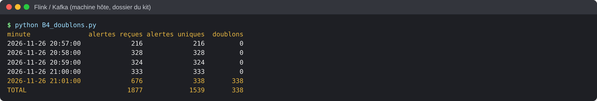
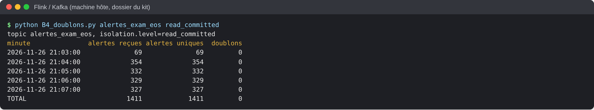
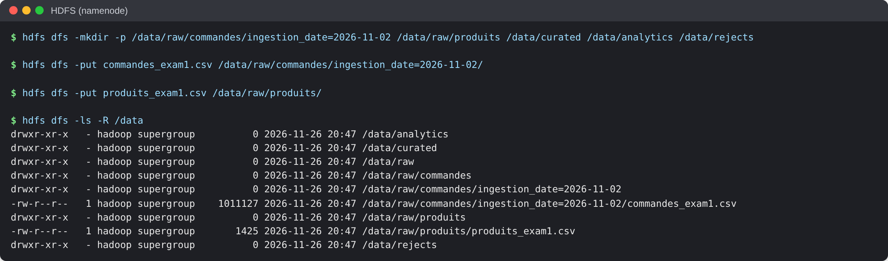
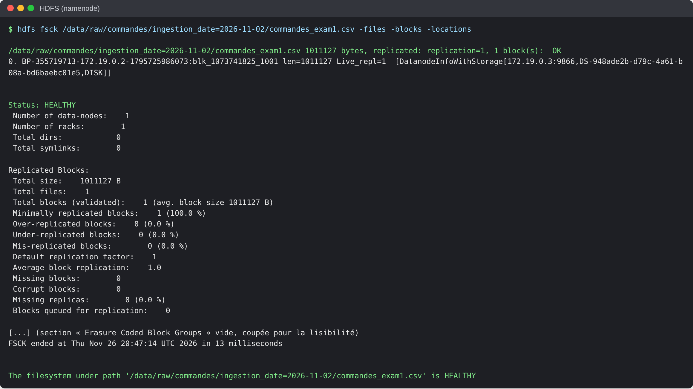
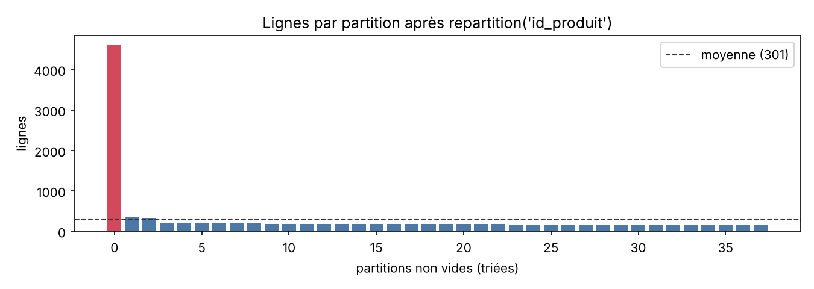
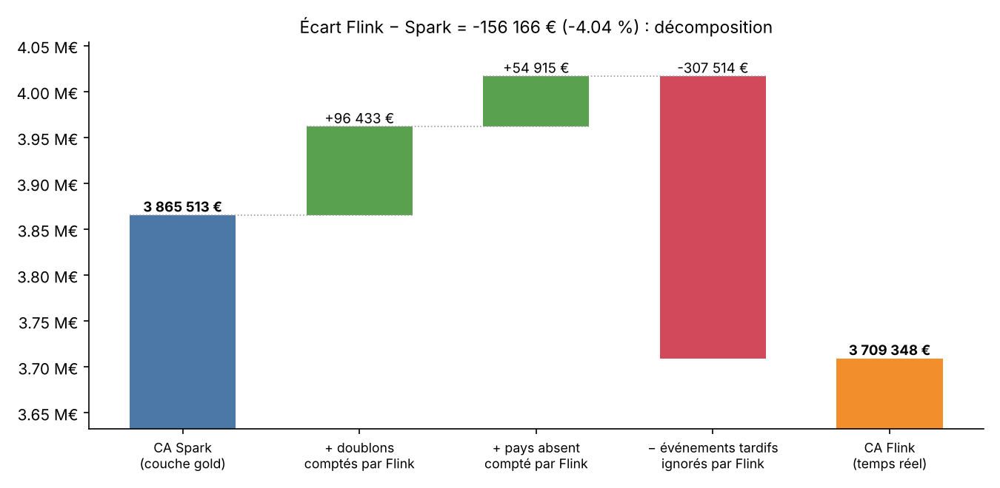
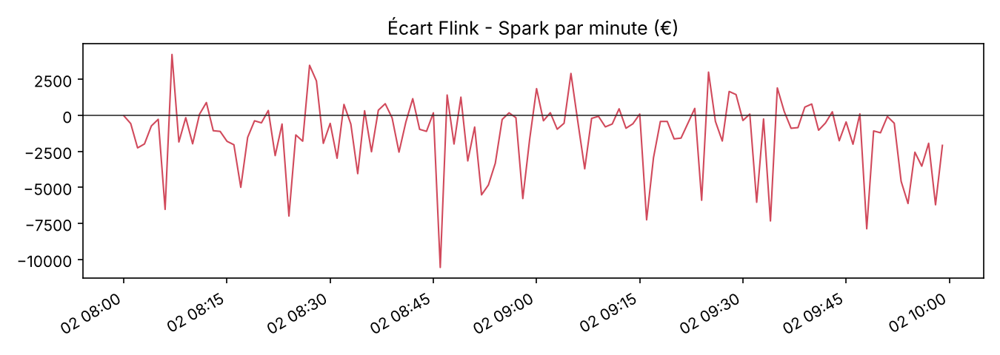

# Avant de commencer

**Mission.** GlobalTech Industries constate que le chiffre d'affaires affiché en temps réel (Flink) ne correspond pas
au chiffre consolidé (Spark). Il faut mettre en place les briques de la chaîne, puis expliquer et chiffrer l'écart.

**Environnement utilisé.**

| Brique | Ce qui a tourné | Remarque |
|---|---|---|
| Kafka | kit du cours : 3 brokers `apache/kafka:3.9.0` en mode KRaft (Docker) | `docker-compose.yml` du kit, inchangé |
| Flink | image du kit : Flink 1.20.1 + connecteur Kafka SQL 3.3.0 | le connecteur a été copié dans l'image au lieu d'être téléchargé pendant le build (problème réseau local) |
| HDFS | `apache/hadoop:3.4.1`, 1 NameNode + 1 DataNode (Docker) | mêmes commandes `hdfs dfs` que sur Colab ; réplication 1 comme un nœud unique Colab |
| Spark | PySpark 4.0.1 en local (`local[4]`) | le notebook tourne tel quel sur Colab (`!pip install pyspark`) |

**Données.** Les fichiers de `Kit_Examen_Etudiants.zip` n'étaient pas disponibles. Un jeu de test **au même format**
a été généré par `donnees/generer_donnees_exam1.py` (graine fixe, résultat identique à chaque exécution) :
12 484 lignes de commandes (12 107 commandes distinctes) sur 120 minutes (2026-11-02, 08:00 à 10:00), 100 entrepôts, 40 produits en 5 familles, avec
des doublons, des pays et prix absents, des quantités nulles ou négatives, des dates invalides, des événements tardifs
et un produit très majoritaire (skew). `ca_minute_flink.csv` applique exactement les règles du job Flink données en E2.
**Avec les vrais fichiers, il suffit de remplacer les trois CSV et de relancer le notebook** : tous les chiffres de D et E
sont recalculés.

**Contenu du dossier de rendu.**

| Dossier | Contenu |
|---|---|
| `donnees/` | les 3 CSV + le script qui les génère |
| `sql/` | fichiers SQL Flink (B1, B3, B4) et scripts de mesure (B1, B4) |
| `spark/` | notebook `TP1_spark_D_E.ipynb` exécuté (et sa version script `.py`) |
| `gold/` | couche gold en Parquet (+ copie CSV lisible) |
| `lake/` | zones `curated` et `rejects` en Parquet |
| `captures/`, `sorties/` | captures d'écran et sorties brutes des commandes |

# Partie A : Kafka

## A1. Dimensionnement

Conventions : 1 Ko = 1 000 octets, 1 Mo = 1 000 Ko, 1 To = 10^6^ Mo. Une journée = 86 400 s.

| Grandeur | Calcul | Résultat |
|---|---|---|
| Débit entrant | 20 000 msg/s × 1 Ko | **20 Mo/s** |
| Débit de réplication entre brokers | RF 3 : chaque message est recopié sur 2 suiveurs, 2 × 20 Mo/s | **40 Mo/s** |
| Débit sortant vers les consommateurs | groupe de 10 consommateurs = 1 lecture du flux (2 Mo/s chacun) + 2 applications × 1 lecture complète : 3 × 20 Mo/s | **60 Mo/s** |
| Débit sortant total des brokers | 60 Mo/s (consommateurs) + 40 Mo/s (réplication) | **100 Mo/s** |
| Stockage brut sur 3 jours | 20 Mo/s × 86 400 s × 3 = 5 184 000 Mo | **5,18 To** |
| Stockage avec réplication | 5,18 To × 3 | **15,55 To** |
| Capacité disque à prévoir | disques remplis à 70 % maximum : 15,55 / 0,7 | **≈ 22 To** |

**Nombre de partitions : 12.**
Hypothèses : une partition encaisse environ 10 Mo/s en écriture, et un consommateur traite environ 2 Mo/s (2 000 msg/s).
Il faut donc au moins 20 / 10 = 2 partitions pour l'écriture, et 20 / 2 = 10 partitions pour que les 10 consommateurs
du groupe travaillent tous : un consommateur sans partition reste inactif. On retient **12** : c'est au-dessus de 10, cela
laisse 20 % de marge (2 consommateurs de plus), et c'est un multiple de 3 et de 4, donc les leaders sont répartis
équitablement sur les brokers. Si une croissance ×2 est prévue, partir directement sur 24 : on ne peut pas réduire le
nombre de partitions, et l'augmenter change la partition associée à chaque clé.

**Nombre de brokers : 4.**
Hypothèse : un broker dispose de 8 To de disque utile, rempli à 70 % maximum, soit 5,6 To.
Stockage : 15,55 / 5,6 = 2,8, donc 3 brokers minimum. Réseau : 100 Mo/s sortants répartis sur 3 brokers donnent
33 Mo/s par broker, bien en dessous d'une carte 1 Gb/s (125 Mo/s). On ajoute **un broker de plus (N+1)** : avec
RF 3 et min.insync.replicas 2, le cluster doit rester confortable pendant la panne ou la maintenance d'un broker.

**Paramètres de durabilité retenus (« aucune perte tolérée »).**

| Niveau | Paramètre | Pourquoi |
|---|---|---|
| Producteur | `acks=all` | le leader n'acquitte qu'une fois le message écrit sur toutes les répliques de l'ISR |
| Producteur | `enable.idempotence=true`, `retries` illimité, `max.in.flight.requests.per.connection=5` | les renvois ne créent ni doublon ni désordre |
| Producteur | `delivery.timeout.ms=120000` | laisse le temps à une élection de leader |
| Topic | `replication.factor=3` | 3 copies de chaque message |
| Topic | `min.insync.replicas=2` | une écriture est refusée plutôt qu'écrite sur une seule copie ; tolère 1 broker en panne |
| Topic | `unclean.leader.election.enable=false` | une réplique en retard ne peut pas devenir leader (sinon perte) |
| Topic | `retention.ms=259200000` (3 jours) | rétention demandée |
| Broker | `auto.create.topics.enable=false`, `broker.rack` renseigné | pas de topic créé par erreur ; répliques réparties sur des baies différentes |

## A2. Manipulation

**1. Cluster démarré et topic créé** : 6 partitions, réplication 3, `min.insync.replicas=3`. Les trois brokers sont
dans l'ISR de chaque partition.


**2. Arrêt du broker kafka3** (un seul broker à la fois). L'ISR de chaque partition tombe à 2 répliques
(`Isr: 1,2`) et les partitions 0 et 3, dont kafka3 était leader, changent de leader.


**3. Écriture avec `acks=all`** : refusée avec `NOT_ENOUGH_REPLICAS`.


**4. Explication.** Avec `acks=all`, le leader n'acquitte un message que lorsque toutes les répliques de l'ISR (les
répliques à jour) l'ont écrit. `min.insync.replicas` fixe la taille minimale de cet ISR pour accepter une écriture. kafka3
étant arrêté, l'ISR ne contient plus que 2 répliques alors que le topic en exige 3 : le leader refuse le message
(`NotEnoughReplicasException`). Le message n'est pas perdu, il est **rejeté** et le producteur le sait. Avec
`min.insync.replicas=3`, la moindre panne bloque donc toutes les écritures.

**5. Correction** : `min.insync.replicas=2`. On tolère la perte d'un broker sans perdre de données, puisque chaque
message acquitté existe encore sur au moins 2 brokers. L'écriture `acks=all` passe : 6 messages écrits puis relus. Le
message refusé à l'étape 3 n'apparaît pas, ce qui confirme qu'il n'avait pas été écrit.


*Le `TimeoutException` en fin de lecture est normal : c'est la fin du consommateur demandée par `--timeout-ms`.*

**6. Redémarrage de kafka3** : il rattrape son retard en lisant les leaders, puis réintègre l'ISR, qui revient à 3 en
4 secondes. Aucune partition n'est sous-répliquée. Une élection « préférée » rend ensuite à kafka3 le rôle de leader de
ses partitions.



# Partie B : Flink SQL

## B1. Trois watermarks

**Méthode.** Trois tables sont déclarées sur le **même** topic `commandes`. Elles ne diffèrent que par le watermark :
5 s (`commandes` de `init.sql`), 30 s et 60 s (`sql/B1_watermarks.sql`). Trois jobs identiques calculent
`COUNT(*)` et `SUM(amount)` par fenêtre TUMBLE d'une minute et écrivent dans trois topics (`ca_wm5`, `ca_wm30`, `ca_wm60`).
Ces topics sont en `message.timestamp.type=LogAppendTime` : l'horodatage Kafka de chaque résultat donne l'heure exacte
d'émission. Les jobs ont été lancés, puis le générateur :
`python generator.py --rate 50 --duration 300 --late-prob 0.1 --max-delay 40`.

Le script `sql/B1_mesure.py` relit ensuite **tout** le topic `commandes` (le nombre réel de commandes par minute) et
les trois sorties.


Les minutes 20:49 et 20:50 sont incomplètes (démarrage du générateur), et la fenêtre 20:54 n'est pas émise en 60 s car le
générateur s'arrête avant. Sur les minutes complètes :

| Minute | Réel | WM 5 s : comptées | délai | WM 30 s : comptées | délai | WM 60 s : comptées | délai |
|---|---|---|---|---|---|---|---|
| 20:51 | 2 895 | 2 821 (−2,6 %) | 5,4 s | 2 890 (−0,2 %) | 30,5 s | 2 895 (0 %) | 60,5 s |
| 20:52 | 2 897 | 2 834 (−2,2 %) | 5,6 s | 2 891 (−0,2 %) | 30,4 s | 2 897 (0 %) | 60,7 s |
| 20:53 | 2 926 | 2 844 (−2,8 %) | 5,3 s | 2 921 (−0,2 %) | 30,5 s | 2 926 (0 %) | 60,4 s |

**Lecture.** Le délai d'émission est le watermark lui-même : la fenêtre se ferme quand le watermark (plus grand `ts` vu
moins la tolérance) dépasse la fin de la minute. Tout événement arrivé après la fermeture est ignoré. Le générateur
retarde 10 % des événements de 1 à 40 s : avec 5 s on perd environ 2,5 % des commandes, avec 30 s on ne perd plus
que celles retardées de plus de 30 s (0,2 %), et avec 60 s, au-dessus du retard maximal, on n'en perd aucune.
**Plus de complétude coûte de la latence.**


## B2. Quel watermark choisir ?

* **(a) Alerte de fraude : 5 s.** Une alerte n'a de valeur que si elle est immédiate ; perdre environ 2,5 % des
  événements tardifs est acceptable pour un signal d'alerte. Si besoin, les événements tardifs peuvent être envoyés vers
  une sortie séparée pour un contrôle a posteriori.
* **(b) Rapport de fin de journée : un watermark au moins égal au retard maximal observé.** Ici le retard maximal est
  de 40 s, donc 60 s donne 100 % des commandes ; 60 s de latence n'a aucune importance pour un rapport lu le lendemain.
  En pratique, ce rapport doit plutôt venir du traitement batch Spark (partie D), qui voit tous les événements, même très
  tardifs.

## B3. Alertes « plus de 3 commandes dans la même minute »

Topic `alertes_exam` créé (3 partitions, RF 3), puis job `sql/B3_alertes_exam.sql`, adapté de `sql/05_alertes.sql` :
fenêtre TUMBLE d'une minute par client et `HAVING COUNT(*) > 3`.


**Remarque.** Le job émet environ 330 alertes par minute. C'est attendu : 50 commandes/s sur 1 000 clients font en
moyenne 3 commandes par client et par minute ; avec une loi de Poisson de moyenne 3, P(X > 3) = 35 %. Pour ce trafic, le
seuil « plus de 3 » est trop bas pour être utile : il faudrait le relever ou le rendre relatif à l'historique du client.

## B4. Panne du TaskManager et doublons

**Observation de la panne** (`docker compose stop taskmanager` pendant que le job tourne) : le job passe en
**RESTARTING**. Ses tâches sont en échec (`FAILED` / `CANCELED`) et il réessaie sans succès :
`NoResourceAvailableException: Could not acquire the minimum required resources`, car il n'y a plus aucun slot.
Après `docker compose start taskmanager`, le job repart (**RUNNING**) **depuis le dernier checkpoint terminé** : les
offsets Kafka et l'état des fenêtres sont restaurés, puis le job relit les commandes arrivées depuis ce checkpoint.


**Le topic peut-il contenir des doublons ? Oui**, avec le puits Kafka par défaut (`at-least-once`). Tout ce qui a été
écrit entre le dernier checkpoint et la panne est recalculé et **réécrit** après la reprise.

**Vérification** (`sql/B4_doublons.py`) : une alerte est identifiée par `(customer_id, w_start)`, puisqu'un client ne peut
avoir qu'une alerte par minute. On relit tout le topic et on compte les clés présentes plusieurs fois.

* **1^er^ essai** : panne juste après l'émission des alertes de la minute 20:59 (vers 21:00:05), **0 doublon**. Le
  checkpoint n°19 (vers 21:00:07) s'était terminé juste après l'émission : les alertes déjà écrites faisaient partie de
  l'état sauvegardé et n'ont pas été rejouées.
* **2^e^ essai** : panne entre l'émission (21:02:05,5) et le checkpoint suivant. **338 doublons** : toutes les alertes de
  la minute 21:01 ont été écrites deux fois.





**Garantie à configurer : exactly-once** de bout en bout (`sql/B4_alertes_exactly_once.sql`) :

* checkpoints activés (déjà fait : toutes les 10 s) ;
* puits Kafka `'sink.delivery-guarantee' = 'exactly-once'` + `'sink.transactional-id-prefix'` : Flink écrit dans une
  **transaction Kafka validée au checkpoint** ;
* consommateurs en `isolation.level=read_committed` : ils ne voient que les transactions validées.

Testé avec la même panne (arrêt brutal après le calcul de la fenêtre de 21:07, avant le checkpoint) : la fenêtre est
recalculée après la reprise et validée **une seule fois**, **0 doublon**.



**Coût de l'exactly-once.**

* **Latence** : les résultats ne sont visibles qu'au commit, donc au checkpoint suivant. Mesuré : 9,1 s après la fin de
  la minute au lieu de 5,5 s ; dans le pire cas, on ajoute un intervalle de checkpoint (10 s).
* **Charge** : transactions, marqueurs de commit, coordinateur de transactions côté Kafka.
* **Contraintes** : tous les consommateurs doivent lire en `read_committed`. `transaction.timeout.ms` doit rester
  inférieur à `transaction.max.timeout.ms` du broker. Une transaction restée ouverte (job arrêté longtemps) bloque la
  lecture `read_committed` jusqu'à son expiration.

Alternative moins chère : garder l'at-least-once et rendre la lecture idempotente, avec une clé `(customer_id, w_start)`
et un topic compacté ou un upsert côté consommateur.

# Partie C : HDFS

## C1. Petits fichiers

* Nombre de fichiers : 100 entrepôts × 60 × 24 × 182 = 100 × 1 440 × 182 = **26 208 000 fichiers**.
* Objets NameNode : 26 208 000 × 2 = 52 416 000 objets × 150 octets = 7 862 400 000 octets, soit **≈ 7,9 Go de mémoire
  NameNode** rien que pour ces fichiers (répertoires non comptés).

**Conclusion.** C'est intenable. Toute la métadonnée HDFS tient dans la mémoire d'un seul NameNode : il faut un tas
JVM énorme, avec de longues pauses GC, un redémarrage lent (chargement du fsimage) et une saturation des appels RPC.
En plus, les fichiers d'une minute sont minuscules par rapport à un bloc de 128 Mo, et un job Spark lance une tâche par
fichier, soit des millions de tâches.

**Stratégie (÷ 60 au moins).** Déposer **un fichier par entrepôt et par heure** au lieu d'un par minute :
100 × 24 × 182 = **436 800 fichiers**, soit 60 fois moins, environ 873 600 objets × 150 o ≈ **131 Mo**. On peut aller plus
loin en ne partitionnant que par date et heure : l'entrepôt devient une colonne, et la taille des fichiers est fixée
par leur volume (128 Mo à 1 Go). Kafka sert de tampon pendant l'accumulation, puisqu'il garde 3 jours de données.

## C2. Manipulation

**Arborescence et chargement des CSV dans la zone raw :**



**fsck sur le fichier des commandes : 1 bloc** (1 011 127 octets, bien moins que 128 Mo) et **réplication effective
1** (`Live_repl=1`, `Average block replication: 1.0`). Il n'y a qu'un DataNode, donc `dfs.replication=1`, comme sur Colab ;
en production on aurait 3.



**Découpage en fichiers de 600 lignes, chargement, mesure et compaction :**


| | Fichiers | Blocs | Objets NameNode | Taille |
|---|---|---|---|---|
| 21 fichiers de 600 lignes | 21 | 21 (48 Ko en moyenne) | 42 | 1 011 127 o |
| après compaction | 1 | 1 | 2 | 1 011 127 o |

Le contenu est identique (même nombre de lignes, même empreinte md5), mais coûte 21 fois plus d'objets au NameNode.
Seul le premier morceau contient l'en-tête CSV : la compaction par concaténation le retrouve bien en tête.

Après la partie D, les zones `curated`, `rejects` et `analytics` ont été alimentées avec les fichiers Parquet produits
par Spark (1 fichier par sortie) :


## C3. Déposer Kafka vers HDFS sans petits fichiers

1. Utiliser un connecteur qui **accumule** avant d'écrire (Kafka Connect HDFS Sink, ou sink fichier de Flink / Spark
   Structured Streaming) au lieu d'écrire chaque message ou chaque minute.
2. Fermer un fichier **à la taille** (128 Mo à 1 Go) **ou au temps** (toutes les heures), en prenant la première
   limite atteinte.
3. Partitionner par **date et heure** (`ingestion_date=…/heure=…`), pas par entrepôt : l'entrepôt reste une colonne.
4. Écrire en format colonne compressé (Parquet ou Avro + Snappy), qui réduit aussi le volume.
5. Lancer chaque nuit une **compaction** de la partition de la veille pour rattraper les fichiers trop petits ; Kafka
   (rétention 3 jours) sert de tampon en cas de retard.

# Partie D : Spark

Notebook : `spark/TP1_spark_D_E.ipynb` (exécuté, sorties visibles). Toutes les colonnes sont lues en texte avec un
schéma imposé : on contrôle soi-même les conversions, sinon une date ou une quantité illisible deviendrait NULL sans
laisser de trace.

## D1. Contrôle qualité (un seul `agg`)

```python
qualite = cmd.agg(
    F.count("*").alias("nb_lignes"),
    F.countDistinct("id_commande").alias("nb_id_commande_distincts"),
    (F.count("*") - F.countDistinct("id_commande")).alias("doublons_id_commande"),
    *[F.sum(F.col(c).isNull().cast("int")).alias(f"null_{c}") for c in COLONNES],
    F.sum((F.col("quantite_i") <= 0).cast("int")).alias("quantite_<=0"),
    F.sum((F.col("ts_evenement").isNotNull() & F.col("ts_evt").isNull()).cast("int")).alias("dates_invalides"))
```

| Contrôle | Valeur | % des lignes |
|---|---|---|
| Nombre de lignes | 12 484 | 100 % |
| `id_commande` distincts | 12 107 | 96,98 % |
| **Doublons sur `id_commande`** | **377** | 3,02 % |
| NULL `id_commande`, `id_entrepot`, `id_produit`, `quantite`, `ts_ingestion` | 0 | 0 % |
| **NULL `pays`** | **190** | 1,52 % |
| **NULL `prix_unitaire`** | **149** | 1,19 % |
| NULL `ts_evenement` (date vide) | 12 | 0,10 % |
| **Quantités ≤ 0** | **249** | 1,99 % |
| **Dates invalides** (renseignées mais illisibles) | **88** | 0,70 % |

Exemples de dates invalides : `2026-02-30 08:12:00.000`, `2026-11-02 25:13:07.000`, `02/11/2026 08:15`, `N/A`.

## D2. Pipeline propre

* **Dédoublonnage** sur `id_commande` : on garde la **première arrivée** (plus petit `ts_ingestion`), avec
  `row_number()` sur une fenêtre par `id_commande`. Les copies sont des renvois du producteur : mêmes valeurs, ingestion
  plus tardive.
* **Motif de rejet** : un seul motif par ligne, dans l'ordre de l'énoncé : `pays_absent`, puis `quantite_invalide`
  (≤ 0 ou illisible), `prix_absent`, `date_invalide` (vide ou illisible). Seules 7 commandes cumulent deux anomalies.
* **Écriture** en deux dossiers Parquet distincts, `lake/curated/commandes` et `lake/rejects/commandes` (motif + date
  de rejet), avec `coalesce(1)` pour ne pas fabriquer de petits fichiers.

**Preuve** (relecture des deux dossiers Parquet écrits) :

```
propres (11449) + rejets (658) = 12107
commandes distinctes                 = 12107
OK : propres + rejets = commandes distinctes
Aucune commande en double après dédoublonnage : True
```

| Motif | Rejets |
|---|---|
| quantite_invalide | 236 |
| pays_absent | 186 |
| prix_absent | 141 |
| date_invalide | 95 |
| **Total** | **658** |

## D3. Jointure et skew

Broadcast automatique et AQE désactivés (`autoBroadcastJoinThreshold = -1`, `adaptive.enabled = false`).
Chiffre d'affaires par famille = `propres.join(produits, "id_produit").groupBy("famille")`.

**Plan** : **SortMergeJoin** et **4 Exchange** : un `hashpartitioning(id_produit)` de chaque côté de la jointure, un
`hashpartitioning(famille)` pour l'agrégation et un `rangepartitioning` pour le tri final.

```
SortMergeJoin [id_produit], [id_produit], Inner
:- Sort  +- Exchange hashpartitioning(id_produit, 200)      <- commandes redistribuées
+- Sort  +- Exchange hashpartitioning(id_produit, 200)      <- produits redistribués
```

**Répartition par `id_produit`** : 40 produits ; **P007 (Webcam) représente 4 611 lignes, soit 40,3 % des commandes**,
alors qu'un produit en compte 286 en moyenne et 176 en médiane.

**Répartition par partition après `repartition('id_produit')`** : sur 200 partitions, **seules 38 sont non vides**
(40 clés, dont certaines partagent une partition) et 162 sont vides. La plus grosse partition contient **4 611 lignes
(40,3 %)**, soit **15,3 fois la moyenne** et **25,8 fois la médiane** des partitions non vides. **Il y a donc un skew
fort** : une seule tâche fait 40 % du travail de la jointure pendant que les autres attendent.



## D4. Correction : broadcast join

La table produits fait **40 lignes (1,4 Ko)**. On la **diffuse** à chaque tâche avec `F.broadcast(produits)` : chaque
tâche joint ses commandes avec sa copie locale des produits. **Les commandes ne sont plus redistribuées par
`id_produit`**, donc le produit majoritaire ne peut plus se retrouver concentré dans une seule tâche.

Mesures sur une copie ×100 des commandes propres (1 144 900 lignes, même distribution), moyenne de 3 exécutions après
échauffement ; métriques par tâche lues dans l'API REST de Spark :

| | Avant (SortMergeJoin) | Après (broadcast) |
|---|---|---|
| Type de jointure | SortMergeJoin | BroadcastHashJoin |
| Exchange (shuffle) | 3 | 1 (+1 BroadcastExchange de 40 lignes) |
| Lignes écrites en shuffle | 1 144 980 | 20 |
| Tâches de l'étape de jointure | 200 (38 non vides) | 4 |
| Lignes de la tâche la plus chargée | 461 101 | 286 226 |
| Lignes de la tâche médiane | 17 851 | 286 225 |
| **Déséquilibre max / médiane** | **25,8** | **1,0** |
| **Durée moyenne** | **1,45 s** | **0,73 s (÷ 2)** |

Les deux versions donnent le même chiffre d'affaires par famille (écart maximal 0,00002 €, arrondi des flottants).

**Pourquoi le broadcast est la meilleure solution ici.**

* La table de dimension est minuscule (40 lignes, très en dessous du seuil de 10 Mo) : la diffuser ne coûte rien, et on
  supprime **toute** la redistribution des commandes. Le skew n'est pas compensé, il disparaît.
* Le **salting** répartirait P007 sur N partitions, mais il faudrait dupliquer N fois la table produits et ajouter du
  code. C'est utile quand les **deux** tables sont grosses, ce qui n'est pas le cas ici.
* L'**AQE** (`skewJoin`) ne découpe que des partitions de plus de 256 Mo, ce qui ne se déclenche pas à cette taille.
  De toute façon, avec les réglages par défaut, Spark choisirait de lui-même un broadcast pour une table aussi petite.

# Partie E : KPI et réconciliation

## E1. Couche gold (Parquet, dossier `gold/`)

**Chiffre d'affaires par pays** (`gold/ca_par_pays`)

| Pays | CA (€) | Commandes | Panier moyen (€) | Part du CA |
|---|---|---|---|---|
| FR | 1 491 084,30 | 4 552 | 327,57 | 38,57 % |
| DE | 581 279,58 | 1 620 | 358,81 | 15,04 % |
| BE | 459 768,94 | 1 374 | 334,62 | 11,89 % |
| ES | 431 090,63 | 1 147 | 375,84 | 11,15 % |
| IT | 349 669,42 | 1 073 | 325,88 | 9,05 % |
| CH | 287 178,09 | 885 | 324,50 | 7,43 % |
| MA | 133 240,54 | 440 | 302,82 | 3,45 % |
| TN | 132 201,83 | 358 | 369,28 | 3,42 % |

**Chiffre d'affaires par famille** (`gold/ca_par_famille`)

| Famille | CA (€) | Commandes | Quantité | Part du CA |
|---|---|---|---|---|
| Informatique | 1 880 673,93 | 5 852 | 18 198 | 48,65 % |
| Réseau | 748 150,97 | 829 | 2 546 | 19,35 % |
| Mobilier | 640 866,96 | 862 | 2 650 | 16,58 % |
| Outillage | 477 369,57 | 1 320 | 4 158 | 12,35 % |
| Consommables | 118 451,90 | 2 586 | 8 182 | 3,06 % |

**Indicateurs** (`gold/indicateurs`) : **11 449 commandes propres**, 658 rejets sur 12 107 commandes distinctes, soit un
**taux de rejet de 5,43 %** (rejets / commandes distinctes, doublons exclus du dénominateur). CA total :
**3 865 513,33 €**. Une table `gold/rejets_par_motif` complète le suivi qualité.

## E2. Réconciliation Flink / Spark

**Méthode.** On rejoue ligne par ligne, sur les données brutes (doublons compris), les règles du job Flink, puis on les
compare aux règles Spark :

* **compté par Flink** : quantité > 0, prix renseigné, date lisible (sinon pas de fenêtre), et `ts_ingestion` ≤ fin de
  la minute + 5 s ; pas de dédoublonnage, pas de contrôle du pays ;
* **compté par Spark** : première arrivée de la commande et aucun motif de rejet.

Chaque ligne contribue `montant × (compté Flink − compté Spark)` à l'écart. Une ligne comptée d'un seul côté l'est pour
une seule raison, donc la décomposition est exacte. **Contrôle préalable** : les règles rejouées redonnent exactement
`ca_minute_flink.csv` (120 minutes, 0 écart sur le nombre de commandes et sur le montant). Les règles sont donc bien
comprises.

| | Lignes | Montant | % du CA Spark |
|---|---|---|---|
| CA Flink (somme des 120 minutes) | | **3 709 347,68 €** | |
| CA Spark (couche gold) | | **3 865 513,33 €** | |
| **Écart Flink − Spark** | | **−156 165,65 €** | **−4,04 %** |
| 1. doublons comptés par Flink | 295 | +96 432,79 € | +2,49 % |
| 2. pays absent compté par Flink | 166 | +54 915,40 € | +1,42 % |
| 3. événements tardifs ignorés par Flink (> 5 s après la fin de leur minute) | 824 | −307 513,84 € | −7,96 % |
| **Somme des causes** | | **−156 165,65 €** | **−4,04 %** |



**À retenir.** L'écart net (−4,04 %) **cache des écarts bruts presque trois fois plus gros** (+3,9 % et −8,0 %) qui se
compensent en partie. Selon les minutes, l'écart va de −10 555 € à +4 235 € : on ne peut pas se contenter d'un écart
global « acceptable ».



**Retard des événements ignorés** (temps entre la fin de leur minute et leur arrivée) : médiane 46 s, 90^e^ centile 86 s,
maximum 116 s. CA encore perdu selon le watermark : 7,96 % à 5 s, 5,60 % à 30 s, 2,75 % à 60 s, **0 % à 120 s**.

**Recommandation pour réduire l'écart.**

1. **Dédoublonner dans Flink** sur `id_commande` (`ROW_NUMBER() OVER (PARTITION BY id_commande ORDER BY proctime) = 1`,
   avec un TTL d'état de quelques heures) : supprime les +2,49 %.
2. **Appliquer les mêmes règles qualité** dans les deux chemins (pays obligatoire), dans un contrat de données commun :
   supprime les +1,42 %.
3. **Événements tardifs** : garder un watermark court pour l'affichage temps réel, mais émettre des **corrections**
   (sortie en upsert par minute, ou recalcul de la minute quand des données tardives arrivent). Sinon, choisir un
   watermark de 120 s pour les usages qui privilégient la complétude.
4. **Présenter Flink comme un chiffre provisoire** et Spark comme le chiffre officiel, avec un contrôle d'écart
   automatique chaque jour (cette réconciliation, industrialisée).

## E3. Restitution : option lake

Trois requêtes Spark SQL sur les tables gold (sorties dans le notebook) :

```sql
-- 1. Top 3 des pays et leur part du CA
SELECT pays, ca, nb_commandes, panier_moyen, part_ca_pct
FROM gold_ca_par_pays ORDER BY ca DESC LIMIT 3;
-- FR 1 491 084,30 € (38,57 %) ; DE 581 279,58 € (15,04 %) ; BE 459 768,94 € (11,89 %)

-- 2. Familles qui pèsent plus de 10 % du CA, avec le CA moyen par article vendu
SELECT famille, ca, part_ca_pct, ROUND(ca / quantite_totale, 2) AS ca_par_article
FROM gold_ca_par_famille WHERE part_ca_pct > 10 ORDER BY ca DESC;
-- Informatique, Réseau, Mobilier, Outillage (Consommables : 3,06 %, exclu)

-- 3. Tableau de bord qualité du jour
SELECT i.date_donnees, i.nb_commandes_propres, i.taux_rejet_pct,
       ROUND(100 * i.nb_doublons / i.nb_lignes_brutes, 2) AS taux_doublons_pct,
       m.motif_rejet AS motif_principal, m.part_des_rejets_pct
FROM gold_indicateurs i
CROSS JOIN (SELECT * FROM gold_rejets_par_motif ORDER BY nb_rejets DESC LIMIT 1) m;
-- 2026-11-02 | 11 449 | 5,43 % | 3,02 % | quantite_invalide | 35,87 %
```

**Dictionnaire de données (couche gold).**

| Table | Colonne | Définition | Règle de calcul |
|---|---|---|---|
| ca_par_pays | pays | pays de la commande (code ISO à 2 lettres) | valeur source, non nulle (sinon rejet) |
| ca_par_pays | ca | chiffre d'affaires en € | Σ quantite × prix_unitaire des commandes propres du pays |
| ca_par_pays | nb_commandes | nombre de commandes propres | COUNT(*) après dédoublonnage et rejets |
| ca_par_pays | panier_moyen | CA moyen par commande | ca / nb_commandes |
| ca_par_pays | part_ca_pct | poids du pays dans le CA | 100 × ca / CA total |
| ca_par_famille | famille | famille du produit | jointure `produits_exam1` sur id_produit |
| ca_par_famille | ca, nb_commandes, part_ca_pct | comme ci-dessus, par famille | idem |
| ca_par_famille | quantite_totale | articles vendus | Σ quantite |
| indicateurs | nb_lignes_brutes | lignes reçues | COUNT(*) du fichier brut |
| indicateurs | nb_doublons | lignes en double | lignes brutes − id_commande distincts |
| indicateurs | nb_commandes_distinctes | commandes uniques | COUNT(DISTINCT id_commande) |
| indicateurs | nb_commandes_propres / nb_rejets | commandes valides / rejetées | motif_rejet NULL / non NULL |
| indicateurs | taux_rejet_pct | part des commandes rejetées | 100 × nb_rejets / nb_commandes_distinctes |
| indicateurs | ca_total | CA officiel du jour | Σ quantite × prix_unitaire des commandes propres |
| rejets_par_motif | motif_rejet, nb_rejets, part_des_rejets_pct | répartition des rejets | COUNT par motif ; 100 × nb / total des rejets |

## E4. Définition du KPI « chiffre d'affaires »

| Élément | Définition |
|---|---|
| Formule | CA = Σ (quantite × prix_unitaire), en euros (hypothèse : prix unitaires HT, hors remises et retours) |
| Inclusion | commandes **distinctes** (dédoublonnées sur id_commande, première arrivée conservée) avec pays renseigné, quantité > 0, prix renseigné et date d'événement valide ; rattachées à la date de **l'événement** (ts_evenement), pas à la date d'ingestion ; les événements tardifs **sont inclus** |
| Exclusion | doublons ; lignes rejetées (conservées dans `/data/rejects` avec leur motif et suivies par le taux de rejet) ; annulations et retours (hors périmètre, hypothèse) |
| Source de vérité | **Spark, couche gold** : complète, dédoublonnée, contrôlée et rejouable. Flink fournit un « CA temps réel **provisoire** », affiché comme tel |
| Fraîcheur attendue | temps réel (Flink) : moins de 70 s (fenêtre d'1 min + watermark 5 s + écriture) ; officiel (Spark) : J+1 avant 8 h |
| Contrôle | réconciliation quotidienne Flink / Spark ; alerte si l'écart dépasse 1 % une fois les corrections E2 appliquées |

# Partie F : synthèse

## Architecture de bout en bout

{width=100%}

## Trois risques de production et leur parade

| Risque | Conséquence | Parade |
|---|---|---|
| **Panne d'un broker ou d'un disque** | écritures bloquées (min.insync trop haut) ou perte de données (acks=1, unclean election) | RF 3, min.insync.replicas 2, acks=all, idempotence, unclean election désactivée, répliques sur des baies différentes, alerte sur les partitions sous-répliquées (vu en A2) |
| **Doublons et incohérences entre temps réel et consolidé** | KPI faux, décisions sur des chiffres qui divergent (vu en B4 et E2) | Flink en exactly-once + lecteurs read_committed, dédoublonnage par id_commande dans les deux chemins, réconciliation automatique quotidienne |
| **Petits fichiers HDFS** | NameNode saturé (7,9 Go de métadonnées en 6 mois), jobs Spark lents (vu en C) | dépôt par taille et par heure, partitionnement par date, compaction nocturne, suivi du nombre de fichiers |

## Une amélioration qui réduit l'écart temps réel / consolidé

**Faire passer les deux chemins par les mêmes données nettoyées.** Un job Flink « qualité » unique lit `commandes`,
dédoublonne sur `id_commande`, applique les règles de rejet et écrit en exactly-once un topic `commandes_propres` (et un
topic `commandes_rejets`). Le calcul temps réel **et** le dépôt dans HDFS lisent ce même topic. Les écarts liés aux
doublons et au pays disparaissent par construction (+3,9 % ici).

Il ne reste que l'écart dû aux événements tardifs. Pour le traiter, on écrit les agrégats dans une table qui accepte les
mises à jour (format lakehouse Iceberg, Delta ou Paimon, ou un topic en upsert) : chaque minute est corrigée quand ses
données tardives arrivent, et Spark comme Power BI lisent la même table.
