# Avant de commencer

**Mission.** GlobalTech Industries constate que le chiffre d'affaires affiché en temps réel (Flink) ne correspond pas
au chiffre consolidé (Spark). Il faut mettre en place les briques de la chaîne, puis expliquer et chiffrer l'écart.

**Le fil rouge.** Chaque partie illustre un compromis qu'il faut savoir justifier :

| Partie | Compromis | Ce qu'on montre |
|---|---|---|
| A. Kafka | durabilité contre disponibilité | une panne doit **bloquer** une écriture plutôt que la **perdre** |
| B. Flink | latence contre complétude ; coût contre garantie de livraison | le watermark décide quels événements comptent ; une reprise peut dupliquer |
| C. HDFS | nombre de fichiers contre mémoire du NameNode | les petits fichiers coûtent cher même quand ils pèsent peu |
| D. Spark | parallélisme contre déséquilibre | une clé majoritaire ralentit tout le job |
| E. KPI | deux définitions donnent deux chiffres | l'écart se décompose cause par cause, à l'euro près |

**Environnement utilisé.**

| Brique | Ce qui a tourné | Remarque |
|---|---|---|
| Kafka | kit du cours : 3 brokers `apache/kafka:3.9.0` en mode KRaft (Docker) | `docker-compose.yml` du kit, inchangé |
| Flink | image du kit : Flink 1.20.1 + connecteur Kafka SQL 3.3.0 | le connecteur a été copié dans l'image au lieu d'être téléchargé pendant le build (problème réseau local) |
| HDFS | `apache/hadoop:3.4.1`, 1 NameNode + 1 DataNode (Docker) | mêmes commandes `hdfs dfs` que sur Colab ; un seul DataNode, donc réplication 1 comme sur Colab |
| Spark | PySpark 4.0.1 en local (`local[4]`) | le notebook tourne tel quel sur Colab (`!pip install pyspark`) |

**Données.** Les fichiers de `Kit_Examen_Etudiants.zip` n'étaient pas disponibles. Un jeu de test **au même format**
a été généré par `donnees/generer_donnees_exam1.py` (graine fixe, résultat identique à chaque exécution) :
12 484 lignes de commandes (12 107 commandes distinctes) sur 120 minutes (2026-11-02, de 08:00 à 10:00), 100 entrepôts,
40 produits en 5 familles. Il contient les anomalies de l'énoncé : doublons, pays et prix absents, quantités nulles ou
négatives, dates invalides, événements tardifs, et un produit très majoritaire (skew). `ca_minute_flink.csv` applique
exactement les règles du job Flink décrites en E2. **Avec les vrais fichiers, il suffit de remplacer les trois CSV et de
relancer le notebook** : tous les chiffres de D et E sont recalculés.

**Contenu du dossier de rendu.**

| Dossier | Contenu |
|---|---|
| `donnees/` | les 3 CSV + le script qui les génère |
| `sql/` | fichiers SQL Flink (B1, B3, B4) et scripts de mesure (A, B1, B4) |
| `spark/` | notebook `TP1_spark_D_E.ipynb` exécuté (et sa version script `.py`) |
| `gold/` | couche gold en Parquet (+ copie CSV lisible) |
| `lake/` | zones `curated` et `rejects` en Parquet |
| `captures/`, `sorties/` | captures d'écran et sorties brutes des commandes |

# Partie A : Kafka

**Rappel du vocabulaire utilisé dans toute la partie.**

* **Partition** : un journal (*log*) ordonné dans lequel on ne fait qu'ajouter des messages à la fin. Chaque message
  y reçoit un numéro croissant, l'**offset**. Un topic est découpé en partitions pour être écrit et lu en parallèle.
* **Réplique** : une copie complète d'une partition sur un broker. Avec une réplication 3, chaque partition existe sur
  3 brokers.
* **Leader** : la réplique qui reçoit toutes les écritures et les lectures de la partition. Les autres répliques
  (**suiveurs**) copient le leader en continu.
* **ISR** (*In-Sync Replicas*, répliques synchronisées) : les répliques **à jour** avec le leader, leader compris. Un
  suiveur reste dans l'ISR tant qu'il a rattrapé le leader depuis moins de `replica.lag.time.max.ms` (30 s par
  défaut) ; sinon il en sort. **Seule une réplique de l'ISR peut devenir leader sans perte**, puisqu'elle possède tous
  les messages acquittés.
* **`acks`** (réglage du producteur) : combien de répliques doivent avoir écrit un message avant que le leader
  réponde « OK ». `acks=all` veut dire « toutes les répliques de l'ISR ».
* **`min.insync.replicas`** (réglage du topic) : la taille minimale de l'ISR pour qu'une écriture `acks=all` soit
  acceptée.

## A1. Dimensionnement

**Pourquoi ce calcul ?** Le débit et le stockage déterminent le nombre de machines, de disques et de partitions. Une
erreur ici se paie soit en panne (sous-dimensionné), soit en coût (sur-dimensionné).

Conventions : 1 Ko = 1 000 octets, 1 Mo = 1 000 Ko, 1 To = 10^6^ Mo. Une journée = 86 400 s.

| Grandeur | Calcul | Résultat | Justification |
|---|---|---|---|
| Débit entrant | 20 000 msg/s × 1 Ko | **20 Mo/s** | ce que les producteurs envoient aux leaders |
| Débit de réplication | 2 × 20 Mo/s | **40 Mo/s** | avec RF 3, le leader a la 1^re^ copie ; les 2 suiveurs recopient chaque message |
| Débit sortant vers les consommateurs | 3 × 20 Mo/s | **60 Mo/s** | le groupe de 10 lit le flux **une fois** (chaque partition n'est lue que par un membre du groupe), et chacune des 2 autres applications le relit en entier |
| Débit sortant total des brokers | 60 + 40 Mo/s | **100 Mo/s** | la réplication sort aussi des leaders, vers les suiveurs |
| Stockage brut sur 3 jours | 20 Mo/s × 86 400 s × 3 | **5,18 To** | ce qui entre pendant la rétention |
| Stockage avec réplication | 5,18 To × 3 | **15,55 To** | chaque octet existe 3 fois |
| Capacité disque à prévoir | 15,55 / 0,7 | **≈ 22 To** | ne pas remplir les disques au-delà de 70 % (pics, index, rattrapage après panne) |

**Nombre de partitions : 12.**
La partition est l'unité de parallélisme : dans un groupe, une partition n'est lue que par un seul consommateur.
Hypothèses : une partition encaisse environ 10 Mo/s en écriture, et un consommateur traite environ 2 Mo/s
(2 000 msg/s). Il faut au moins 20 / 10 = 2 partitions pour l'écriture, et 20 / 2 = **10** pour que les 10
consommateurs travaillent ; avec moins de 10, certains resteraient inactifs. On retient **12** :

* au-dessus de 10, avec 20 % de marge (2 consommateurs de plus si le débit monte) ;
* multiple de 3 et de 4 : les leaders se répartissent équitablement, que le cluster ait 3 ou 4 brokers.

Pourquoi pas beaucoup plus ? Chaque partition coûte : fichiers ouverts, élection de leader en cas de panne, mémoire
côté clients, et des batchs plus petits. On ne peut pas **réduire** le nombre de partitions, et l'**augmenter** change la
partition associée à chaque clé, ce qui casse l'ordre par client. Si une croissance ×2 est prévue, partir sur 24.

**Nombre de brokers : 4.**
Hypothèse : un broker dispose de 8 To utiles, remplis à 70 % maximum, soit 5,6 To.

* Stockage : 15,55 / 5,6 = 2,8, donc 3 brokers minimum.
* Réseau : 100 Mo/s sortants sur 3 brokers, soit 33 Mo/s par broker, très en dessous d'une carte 1 Gb/s (125 Mo/s).
* Tolérance : avec RF 3 et `min.insync.replicas=2`, perdre un broker ne bloque rien, mais pendant une maintenance une
  seconde panne bloquerait les écritures. On ajoute donc **un broker de marge (N+1)**.

**Paramètres de durabilité retenus (« aucune perte tolérée »).**

| Niveau | Paramètre | Pourquoi |
|---|---|---|
| Producteur | `acks=all` | le leader n'acquitte qu'une fois le message écrit sur toutes les répliques de l'ISR : un message acquitté survit à la perte du leader |
| Producteur | `enable.idempotence=true`, `retries` illimité, `max.in.flight.requests.per.connection=5` | le producteur peut renvoyer sans créer de doublon : chaque batch porte un identifiant de producteur et un numéro de séquence que le broker vérifie |
| Producteur | `delivery.timeout.ms=120000` | laisse le temps à une élection de leader avant d'abandonner |
| Topic | `replication.factor=3` | 3 copies de chaque message |
| Topic | `min.insync.replicas=2` | refuse une écriture qui n'aurait qu'une copie ; tolère 1 broker en panne (démontré en A2) |
| Topic | `unclean.leader.election.enable=false` | une réplique hors ISR, donc en retard, ne peut pas devenir leader : sinon les messages qu'elle n'a pas seraient perdus |
| Topic | `retention.ms=259200000` (3 jours) | rétention demandée ; la valeur par défaut est de 7 jours (vérifié sur le cluster) |
| Broker | `auto.create.topics.enable=false`, `broker.rack` renseigné | pas de topic créé par erreur avec de mauvais réglages ; les 3 copies sur 3 baies différentes |

**Optimisation de la rétention : compresser.** Les 15,55 To supposent des messages non compressés. Sur le cluster, les
**mêmes 30 000 commandes** ont été envoyées avec quatre réglages producteur (`sql/A_compression_test.py`), puis on a
mesuré la taille réelle du segment sur le broker :

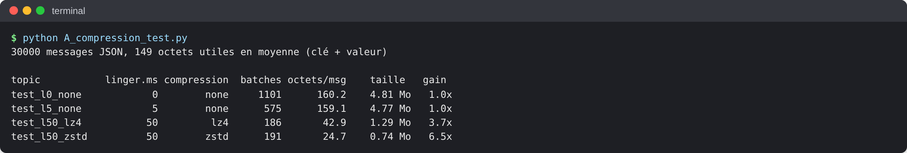

Le producteur compresse des **batchs** entiers. Plus un batch contient de messages (`linger.ms` : attendre quelques ms
pour regrouper), plus la compression trouve de répétitions : clés JSON, noms de pays, formats de date. Le broker stocke
le batch tel quel (`compression.type=producer`), et le consommateur le décompresse. On gagne donc **à la fois** sur le
disque, le réseau et la réplication. Avec zstd (×6,5), les 15,55 To passent à environ **2,4 To** ; avec lz4 (×3,7),
à environ 4,2 To. lz4 coûte moins de CPU, zstd compresse mieux.

À noter : le générateur du kit (50 msg/s, `linger.ms=5`, 6 partitions) envoie **un message par batch** (`count: 1` dans
`kafka-dump-log`), soit 219 octets stockés pour 149 octets utiles.

## A2. Manipulation

**Pourquoi cette manipulation ?** Elle montre que `acks` et `min.insync.replicas` décident de ce qui se passe quand un
broker tombe : soit on **refuse** l'écriture, soit on la **perd**.

### Étape 1 : création du topic

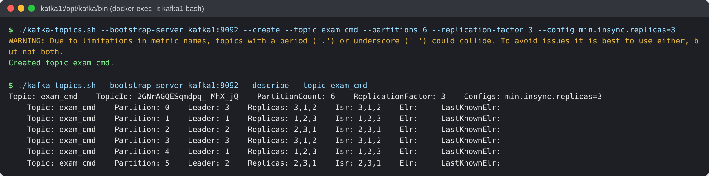

**Comment lire `--describe`** (une ligne par partition) :

| Colonne | Signification | Ce qu'on voit |
|---|---|---|
| `Leader` | broker (identifiant 1, 2 ou 3) qui reçoit les écritures et les lectures | 3, 1, 2, 3, 1, 2 : chaque broker est leader de 2 partitions, donc la charge est répartie |
| `Replicas` | brokers qui ont une copie de la partition ; le premier est le **leader préféré** | toujours les 3 brokers (RF 3), dans un ordre décalé d'une partition à l'autre |
| `Isr` | répliques à jour avec le leader | les 3 répliques partout : tout est synchronisé |
| `Elr` / `LastKnownElr` | « Eligible Leader Replicas » (KIP-966), une fonctionnalité récente non activée ici | vide |
| `Configs` | réglages propres au topic | `min.insync.replicas=3` |

Le `WARNING` vient de l'underscore dans le nom (`exam_cmd`) : dans les noms de métriques, `_` et `.` peuvent entrer en
collision. Il est sans conséquence ici.

### Étape 2 : arrêt de kafka3

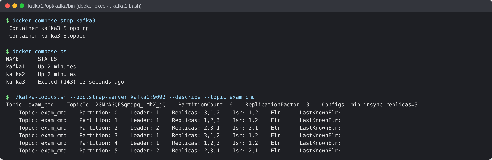

**Ce qui change** (à comparer avec l'étape 1) :

* `Isr` passe de 3 à **2 répliques** (`1,2`) partout : kafka3, arrêté, n'est plus synchronisé.
* `Replicas` ne change pas : c'est l'**affectation** des copies, pas leur état. kafka3 reste prévu pour revenir.
* Les partitions 0 et 3, dont kafka3 était leader, ont un **nouveau leader** (1), pris dans l'ISR. Le contrôleur
  KRaft a fait cette élection automatiquement. kafka3 était aussi leader du quorum de contrôleurs
  (`LeaderId: 3`) ; les deux contrôleurs restants (2 sur 3, la majorité) en ont élu un nouveau.
* Le topic accepte toujours les **lectures**, puisque chaque partition a un leader.

### Étape 3 : écriture avec `acks=all`

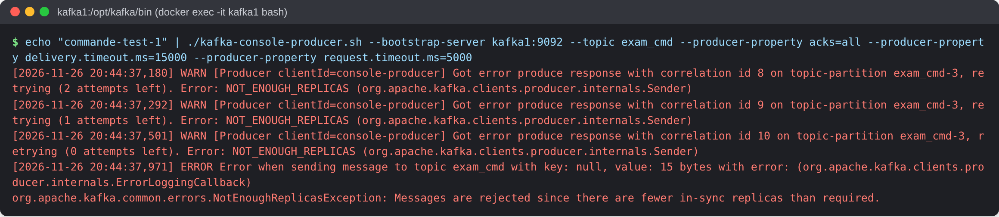

**Comment lire la sortie :** le producteur envoie le message à la partition 3, dont le leader (broker 1) répond
`NOT_ENOUGH_REPLICAS`. Le producteur réessaie (`2, 1, 0 attempts left`), puis abandonne avec
`NotEnoughReplicasException: Messages are rejected since there are fewer in-sync replicas than required`.

### Étape 4 : explication

Avec `acks=all`, le leader ne répond « OK » que lorsque **toutes les répliques de l'ISR** ont écrit le message. Pour
éviter qu'un ISR réduit au seul leader suffise, `min.insync.replicas` impose une taille minimale d'ISR. Ici l'ISR ne
contient plus que **2** répliques alors que le topic en exige **3** : le leader refuse le message **avant de l'écrire**.
Le message n'est donc pas perdu, il est **rejeté**, et le producteur le sait. Avec `min.insync.replicas=3` et RF 3, la
moindre panne bloque toutes les écritures : on a choisi la cohérence au détriment de la disponibilité.

| `acks` | `min.insync.replicas` | Si un broker tombe | Risque |
|---|---|---|---|
| `1` | (ignoré) | l'écriture passe | **perte** si le leader meurt avant que les suiveurs aient copié |
| `all` | 1 | l'écriture passe même avec une seule copie | **perte** si cette dernière copie disparaît |
| `all` | **2** | l'écriture passe (2 copies restent) | aucun, tant qu'il reste 2 brokers |
| `all` | 3 | l'écriture est **refusée** | aucune perte, mais plus de disponibilité (vu ici) |

### Étape 5 : correction et preuve

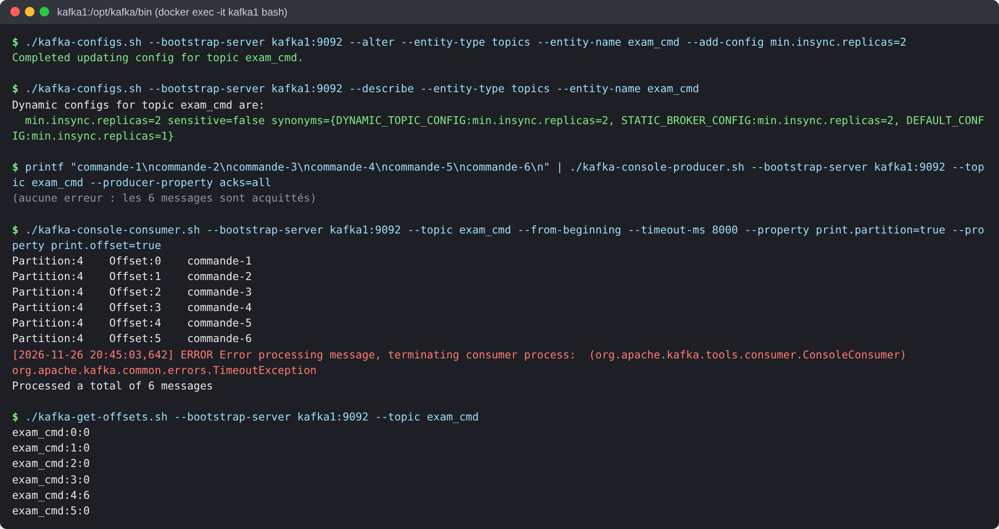

**Comment lire :**

* `kafka-configs --alter` passe `min.insync.replicas` à **2** pour ce topic. Le `--describe` montre l'ordre de
  priorité des réglages : `DYNAMIC_TOPIC_CONFIG=2` (notre réglage sur le topic) l'emporte sur
  `STATIC_BROKER_CONFIG=2` (défini dans `docker-compose.yml`), qui l'emporte sur `DEFAULT_CONFIG=1` (défaut de Kafka).
* Les 6 messages sont acquittés : l'ISR (2) atteint le minimum exigé (2).
* Le consommateur relit les 6 messages, **tous dans la partition 4**. Sans clé, le producteur remplit un batch pour une
  partition avant de passer à la suivante (partitionneur « collant ») : 6 petits messages tiennent dans un seul batch.
* `kafka-get-offsets` donne la fin de chaque partition : 6 messages en partition 4, 0 ailleurs. Le message refusé à
  l'étape 3 n'apparaît nulle part : il n'a jamais été écrit.
* Le `TimeoutException` final est normal : c'est la fin du consommateur demandée par `--timeout-ms`.

Pourquoi `min.insync.replicas=2` ne perd rien : un message acquitté est écrit sur au moins 2 brokers. Si l'un meurt,
l'autre a le message, il est dans l'ISR et peut devenir leader.

### Étape 6 : retour de kafka3


**Comment lire :**

* kafka3 redémarre, relit son disque, puis **rattrape** les messages écrits pendant son absence en les lisant chez les
  leaders (ici les 6 messages de la partition 4). Une fois à jour, il réintègre l'ISR : **`Isr: 1,2,3` partout, en
  4 secondes**.
* `--under-replicated-partitions` ne renvoie rien : aucune partition n'a moins de répliques synchronisées que prévu.
* `kafka-get-offsets` interrogé **sur kafka3** donne les mêmes offsets : sa copie est complète.
* Les partitions 0 et 3 restent menées par le broker 1 juste après le retour. L'**élection préférée** remet le premier
  broker de `Replicas` (kafka3) comme leader, ce qui rééquilibre la charge. Kafka le fait aussi tout seul toutes les
  5 minutes (`auto.leader.rebalance.enable`).

# Partie B : Flink SQL

**Rappel du vocabulaire.**

* **Temps d'événement** (`ts`) : l'heure à laquelle la commande a eu lieu, écrite dans le message. On l'oppose au
  **temps de traitement** (l'horloge de la machine Flink). Le temps d'événement donne le même résultat même si les
  messages arrivent en retard, ou si on relance le traitement plus tard.
* **Fenêtre TUMBLE d'une minute** : chaque événement est rangé dans la minute de son `ts` ; Flink tient pour chaque
  fenêtre (et chaque clé) un accumulateur, ici `COUNT` et `SUM`.
* **Watermark** : l'affirmation « je ne recevrai plus d'événement antérieur à W ». Avec
  `WATERMARK FOR ts AS ts - INTERVAL '5' SECOND`, Flink prend W = plus grand `ts` vu − 5 s. Une fenêtre est **émise puis
  fermée** quand W dépasse sa fin. Un événement qui arrive ensuite pour cette fenêtre est **ignoré**.

## B1. Trois watermarks

**Pourquoi cette manipulation ?** Elle montre le compromis du watermark : attendre plus longtemps donne des résultats
plus complets, mais plus tard.

**Méthode.**

* Trois tables sont déclarées sur le **même** topic `commandes` ; elles ne diffèrent que par le watermark : 5 s
  (`commandes` de `init.sql`), 30 s et 60 s (`sql/B1_watermarks.sql`). Chacune a son propre `group.id`, pour que
  les trois jobs lisent tout le flux.
* Trois jobs identiques calculent `COUNT(*)` et `SUM(amount)` par minute et écrivent dans `ca_wm5`, `ca_wm30`,
  `ca_wm60`.
* **Mesure du délai** : ces topics sont créés avec `message.timestamp.type=LogAppendTime`. Le broker horodate chaque
  résultat au moment où il le reçoit, ce qui donne l'heure exacte d'émission par Flink. Délai = cet horodatage − fin de
  la minute.
* **Mesure de la perte** : `sql/B1_mesure.py` relit **tout** le topic `commandes` et compte, par minute de `ts`, les
  commandes réellement produites. C'est la référence (« réel »).
* Générateur : `python generator.py --rate 50 --duration 300 --late-prob 0.1 --max-delay 40`. 10 % des événements
  reçoivent un `ts` antérieur de 1 à 40 s à leur envoi.

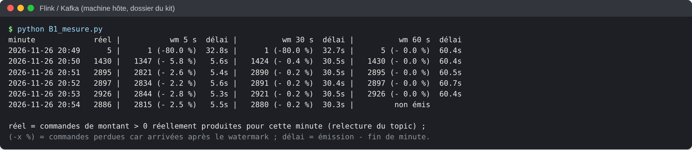

Les minutes 20:49 et 20:50 sont incomplètes (démarrage du générateur), et la minute 20:54 n'est pas émise avec 60 s car
le générateur s'arrête avant que le watermark ait avancé d'une minute de plus. Sur les minutes complètes :

| Minute | Réel | WM 5 s : comptées | délai | WM 30 s : comptées | délai | WM 60 s : comptées | délai |
|---|---|---|---|---|---|---|---|
| 20:51 | 2 895 | 2 821 (−2,6 %) | 5,4 s | 2 890 (−0,2 %) | 30,5 s | 2 895 (0 %) | 60,5 s |
| 20:52 | 2 897 | 2 834 (−2,2 %) | 5,6 s | 2 891 (−0,2 %) | 30,4 s | 2 897 (0 %) | 60,7 s |
| 20:53 | 2 926 | 2 844 (−2,8 %) | 5,3 s | 2 921 (−0,2 %) | 30,5 s | 2 926 (0 %) | 60,4 s |

**Pourquoi le délai vaut le watermark.** La minute [20:52, 20:53[ est émise quand W ≥ 20:53:00, c'est-à-dire quand
Flink a vu un événement daté de 20:53:05 (avec 5 s). Les événements arrivant en temps réel, cela se produit vers
20:53:05 à l'horloge, plus quelques centaines de ms de traitement : **5,6 s mesurées**. Même raisonnement pour 30 s et 60 s.

**Pourquoi ces pertes : le calcul les prévoit.** Un événement de la seconde s de la minute (s entre 0 et 60), retardé
de d secondes, arrive à 60 + (s + d − 60) ; il est perdu s'il arrive après la fermeture, soit si s + d > 60 + délai du
watermark. Avec 10 % d'événements retardés, d uniforme entre 1 et 40 s et s uniforme sur la minute :

| Watermark | Condition de perte | Perte théorique | Perte mesurée |
|---|---|---|---|
| 5 s | s + d > 65 | 10 % × 26,2 % = **2,62 %** | 2,2 à 2,8 % |
| 30 s | s + d > 90 | 10 % × 2,1 % = **0,21 %** | 0,2 % |
| 60 s | s + d > 120, impossible car d ≤ 40 | **0 %** | 0 % |

La mesure colle au calcul : **plus de complétude coûte de la latence**, et le bon watermark est celui qui couvre le
retard maximal réellement observé.

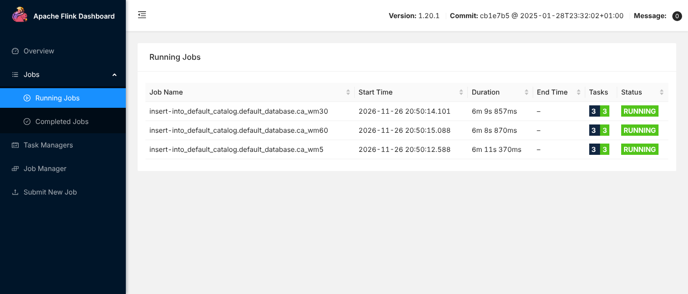

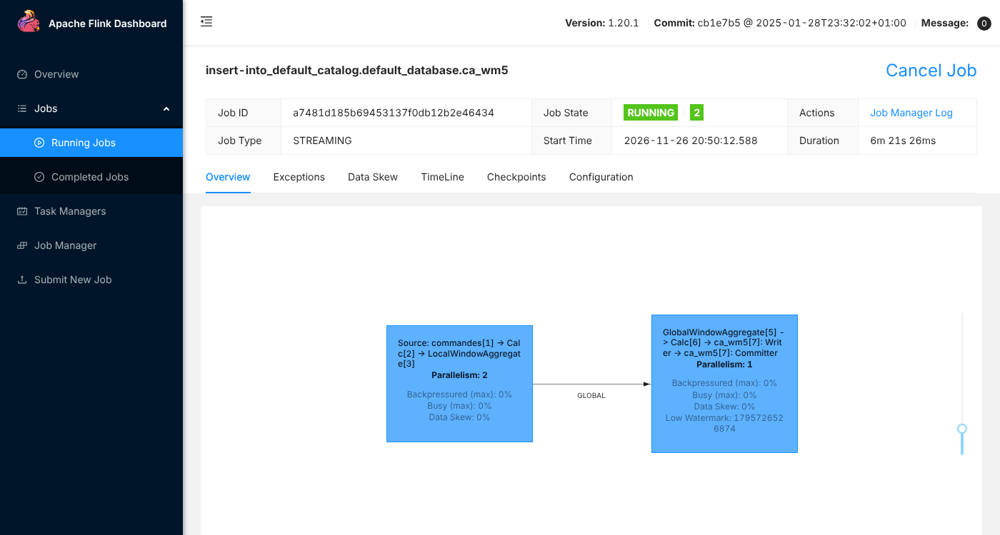

**Comment lire le graphe du job.** Flink a découpé le calcul en deux étapes :

* **Source → Calc → LocalWindowAggregate** (parallélisme 2) : chaque sous-tâche lit 3 des 6 partitions, filtre
  `amount > 0` (`Calc`), puis **pré-agrège** localement.
* **GlobalWindowAggregate → Writer** (parallélisme 1) : il additionne les pré-agrégats.

Cette agrégation en deux phases est une optimisation : on n'envoie sur le réseau qu'un résultat partiel par sous-tâche,
au lieu de chaque commande. Le parallélisme est de 1 parce que le CA par minute n'a pas de clé de regroupement : il n'y
a qu'un total par minute. Le `Low Watermark` affiché est le watermark courant, en millisecondes depuis 1970.

## B2. Quel watermark choisir ?

* **(a) Alerte de fraude : 5 s.** Une alerte n'a de valeur que si elle est immédiate : 5,6 s au lieu de 60 s. Rater
  environ 2,6 % des événements, ceux très en retard, est acceptable pour un signal d'alerte, car le batch les rattrape.
  On pourrait envoyer ces retardataires vers une sortie séparée pour un contrôle a posteriori.
* **(b) Rapport de fin de journée : un watermark au moins égal au retard maximal (ici 40 s, donc 60 s).** La complétude
  prime, et attendre 60 s n'a aucune importance pour un rapport lu le lendemain. En pratique, ce rapport doit plutôt
  venir du **batch Spark** (partie D), qui voit tous les événements, même très en retard.

**Règle générale** : choisir le watermark d'après la distribution des retards (par exemple le 99^e^ centile) et le coût
d'une donnée manquée pour l'usage concerné.

## B3. Alertes « plus de 3 commandes dans la même minute »

**Méthode.** Topic `alertes_exam` créé (3 partitions, RF 3), puis job `sql/B3_alertes_exam.sql`, adapté de
`sql/05_alertes.sql` : fenêtre TUMBLE d'une minute **regroupée par client** (`GROUP BY customer_id, window_start,
window_end`) et filtre `HAVING COUNT(*) > 3`. Le `HAVING` s'applique après l'agrégation, sur le nombre de commandes du
client dans la minute.

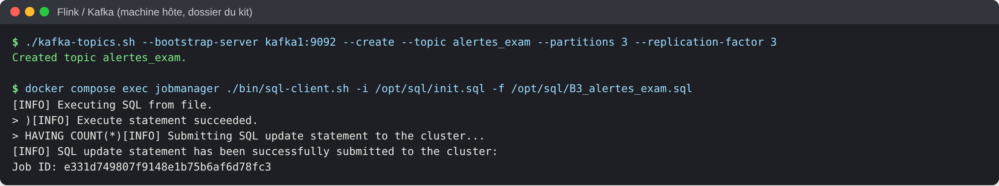

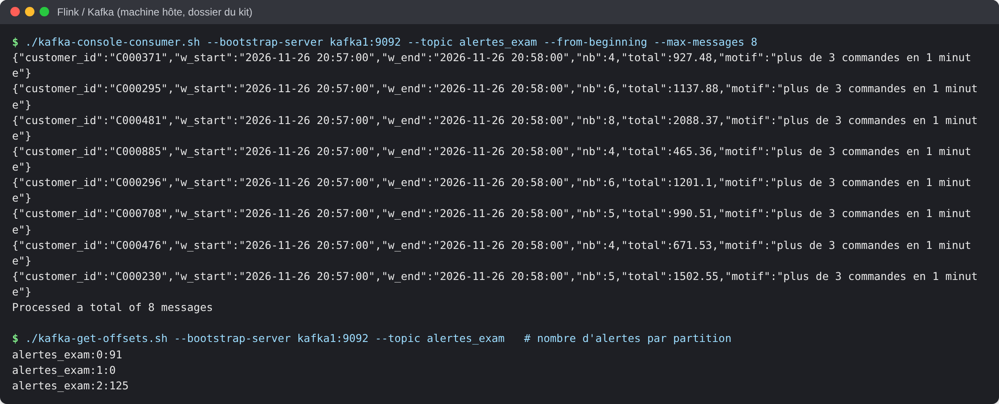

**Comment lire une alerte :** `customer_id` est le client, `w_start` et `w_end` la minute concernée, `nb` le nombre de
commandes (4 ou plus), `total` leur montant cumulé, `motif` la règle déclenchée. `kafka-get-offsets` donne le nombre
d'alertes par partition. La partition 1 est vide parce que les alertes sont écrites **sans clé** : le producteur
remplit une partition à la fois.

**Le volume d'alertes est-il normal ? Le calcul le prévoit.** 50 commandes/s × 60 s × 97 % de montants positifs, sur
1 000 clients, donnent en moyenne λ = 2,91 commandes par client et par minute. Avec une loi de Poisson,
P(X > 3) = 33,3 %, soit **333 alertes attendues par minute** ; on en observe **324 à 338**. La règle est donc mal
calibrée pour ce trafic : un tiers des clients déclenchent une alerte. Il faudrait relever le seuil, ou le rendre
relatif à l'historique du client.

## B4. Panne du TaskManager et doublons

**Pourquoi cette manipulation ?** Flink garantit qu'**après une panne son état est exact**, mais ce qui a déjà été
envoyé à l'extérieur peut être renvoyé. On le vérifie.

**Rappel : qu'est-ce qu'un checkpoint ?** Toutes les 10 s (réglage de `init.sql`), Flink prend une photo **cohérente**
de tout le job :

* les **offsets** Kafka lus par chaque source ;
* l'**état** de chaque opérateur : les accumulateurs des fenêtres ouvertes, client par client, et leurs timers ;
* l'état du **puits** Kafka.

Après une panne, Flink recharge la dernière photo, repositionne la lecture Kafka sur ces offsets et **relit tout ce qui
a suivi**. Le contenu réel d'un checkpoint de ce job est détaillé plus bas.

**Observation de la panne** (`docker compose stop taskmanager`) :

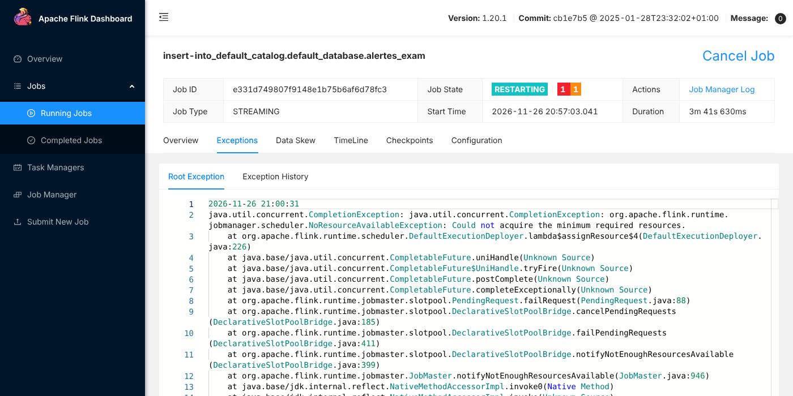

**Comment lire :** le TaskManager est le processus qui exécute les tâches. Sans lui, les tâches passent en `FAILED` /
`CANCELED` et le job en **RESTARTING**. Flink réessaie avec un délai croissant (stratégie de redémarrage par défaut quand
les checkpoints sont actifs), mais échoue : `NoResourceAvailableException: Could not acquire the minimum required
resources`, car il n'existe plus aucun *slot*, l'emplacement d'exécution fourni par un TaskManager.

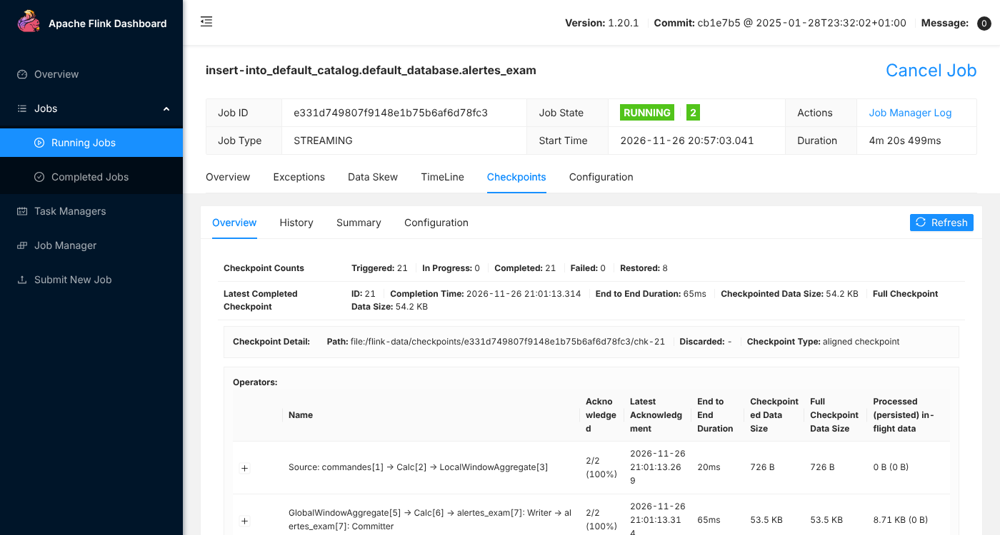

**Comment lire :** après `docker compose start taskmanager`, le job repart en **RUNNING**. L'onglet Checkpoints indique
`Restored: 8`, le nombre de tentatives de restauration pendant la panne. L'état restauré est petit : 54,2 Ko, dont
53,5 Ko pour l'agrégat de fenêtres et le puits, et 726 octets pour la source (ses offsets).

**Le topic peut-il contenir des doublons ? Oui**, avec le puits Kafka par défaut (`at-least-once`). Les alertes émises
**entre le dernier checkpoint et la panne** ne sont pas dans l'état sauvegardé. Après la reprise, Flink relit les
commandes correspondantes, recalcule la fenêtre et **réécrit** ces alertes.

**Comment le vérifier** (`sql/B4_doublons.py`) : une alerte est identifiée par `(customer_id, w_start)`, puisqu'un
client ne peut avoir qu'une alerte par minute. On relit tout le topic et on compte les clés présentes plusieurs fois.

* **1^er^ essai : 0 doublon.** La panne est arrivée juste après l'émission des alertes de 20:59 (vers 21:00:05), mais
  le checkpoint n°19 s'était terminé **après** cette émission, vers 21:00:07. Les alertes étaient donc déjà couvertes par
  l'état sauvegardé, et rien n'a été rejoué.
* **2^e^ essai : 338 doublons.** Panne provoquée **entre** l'émission (21:02:05,5) et le checkpoint suivant. La reprise
  part du checkpoint n°26, terminé avant l'émission : toute la minute 21:01 est recalculée et réécrite.


Les deux essais montrent que **les doublons dépendent du moment exact de la panne**. On ne peut pas compter sur la
chance : il faut une garantie.

**Garantie à configurer : exactly-once de bout en bout** (`sql/B4_alertes_exactly_once.sql`). Il faut trois
éléments :

1. une source **rejouable** (Kafka) et des checkpoints actifs ;
2. un puits **transactionnel** : `'sink.delivery-guarantee' = 'exactly-once'` + `'sink.transactional-id-prefix'`.
   Flink écrit les résultats dans une **transaction Kafka** ouverte, et ne la **valide qu'à la fin du checkpoint**.
   C'est un *commit en deux phases* : préparation au checkpoint, validation quand le checkpoint est confirmé ;
3. des lecteurs en `isolation.level=read_committed`, qui ne voient que les transactions validées.

**Preuve n°1 : la chronologie d'une fenêtre** (`sql/B4_chronologie_exactly_once.py`). On compare le *high watermark*
(HW, tout ce qui est écrit dans le topic) et le *last stable offset* (LSO, ce qu'un lecteur `read_committed` peut lire) :

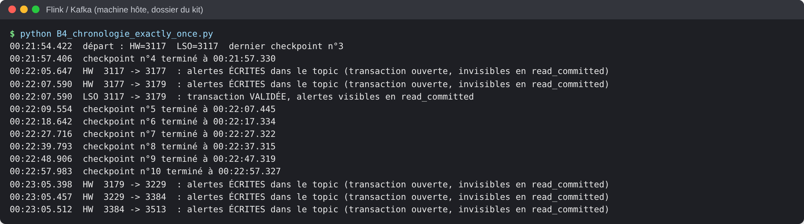

À 00:22:05,6, les alertes sont **écrites** (le HW monte) mais invisibles. Le checkpoint n°5 se termine à 00:22:07,4 ;
Flink valide alors la transaction et, à 00:22:07,6, le **LSO** rattrape le HW. Les alertes deviennent lisibles. Les
2 offsets en plus sont les **marqueurs de commit** écrits par Kafka.

**Preuve n°2 : une panne avant la validation.** Le TaskManager a été arrêté brutalement à 21:08:06,5, après le calcul de
la fenêtre 21:07 et avant le checkpoint. La transaction en cours a été **annulée**, puis la fenêtre recalculée et
validée après la reprise :

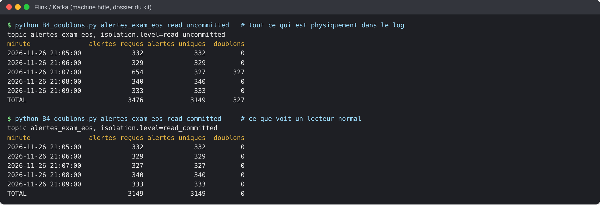

En `read_uncommitted`, on voit tout ce qui est physiquement dans le log : **654 alertes pour 21:07**, les 327 de la
transaction annulée et les 327 de la transaction validée. En `read_committed`, un lecteur normal n'en voit que **327 :
0 doublon**.

**Coût de l'exactly-once.**

* **Latence** : les résultats ne sont visibles qu'à la fin du checkpoint suivant. Mesuré : 9,1 s après la fin de la
  minute au lieu de 5,5 s ; dans le pire cas, un intervalle de checkpoint complet (10 s) en plus.
* **Charge** : transactions, marqueurs de commit, coordinateur de transactions côté Kafka (topic interne
  `__transaction_state`).
* **Contraintes** : tous les lecteurs doivent lire en `read_committed` (sinon ils voient aussi les transactions
  annulées, comme ci-dessus). `transaction.timeout.ms` doit rester inférieur à `transaction.max.timeout.ms` du broker.
  Une transaction restée ouverte bloque les lecteurs `read_committed` derrière elle jusqu'à son expiration.

**Alternative moins chère** : garder l'at-least-once et rendre la lecture **idempotente**. Avec la clé `(customer_id,
w_start)` et un topic compacté (ou un upsert côté lecteur), un doublon écrase simplement la version précédente.

**Contenu réel d'un checkpoint de ce job :**

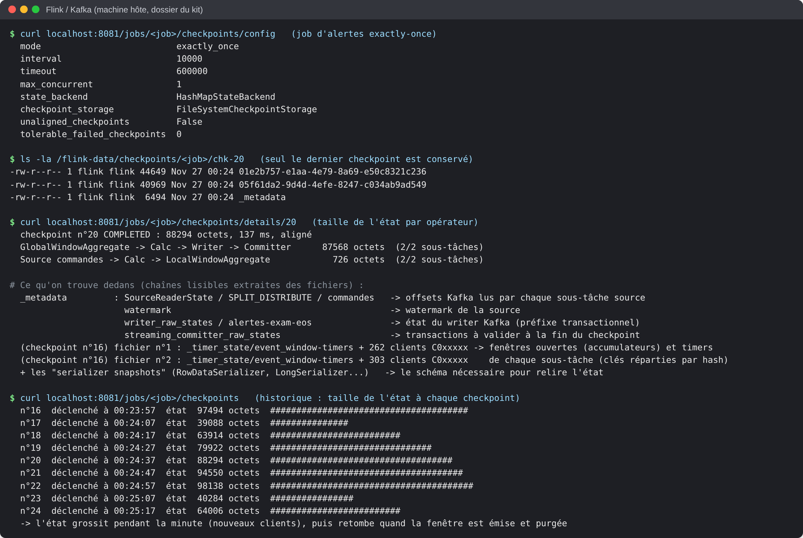

* **`_metadata`** (6,5 Ko) : l'index du checkpoint. Il contient directement les petits états : les **offsets Kafka**
  de chaque sous-tâche source (`SourceReaderState`, topic `commandes`), son **watermark**, l'**état du writer Kafka** et
  la liste des **transactions à valider** (`writer_raw_states`, `streaming_committer_raw_states`).
* **un fichier par sous-tâche de l'agrégat** (environ 40 Ko chacun) : l'**état par clé**, c'est-à-dire l'accumulateur
  de la fenêtre ouverte pour chacun des 262 + 303 clients actifs (chaque sous-tâche gère sa part des clés), plus les
  **timers** event-time (`_timer_state/event_window-timers`) qui déclencheront l'émission à la fin de la minute.
* l'historique montre un **état en dents de scie** : il grossit pendant la minute (de nouveaux clients commandent) et
  retombe juste après xx:05, quand la fenêtre est émise puis purgée.
* les commandes elles-mêmes ne sont **pas** dans le checkpoint : c'est Kafka qui les conserve, d'où la nécessité d'une
  source rejouable.

# Partie C : HDFS

**Rappel.** HDFS découpe chaque fichier en **blocs** de 128 Mo, copiés (par défaut 3 fois) sur des **DataNodes**. Le
**NameNode** garde en mémoire vive toute la carte du système : chaque fichier, chaque répertoire et chaque bloc
(environ 150 octets par objet). Sa mémoire limite donc le **nombre** de fichiers, quelle que soit leur taille.

## C1. Petits fichiers

* Nombre de fichiers : 100 entrepôts × 60 × 24 × 182 = 100 × 1 440 × 182 = **26 208 000 fichiers**.
* Objets NameNode : chaque fichier fait moins de 128 Mo, donc 1 fichier = 1 bloc = 2 objets.
  26 208 000 × 2 × 150 octets = 7 862 400 000 octets, soit **≈ 7,9 Go de mémoire NameNode** rien que pour ces fichiers.

**Conclusion.** C'est intenable, pour quatre raisons :

* **Mémoire** : une seule JVM doit tenir 7,9 Go de métadonnées, et ce chiffre double tous les 6 mois. Cela entraîne de
  longues pauses de ramasse-miettes et un redémarrage lent (rechargement du fsimage).
* **Charge** : chaque ouverture, liste ou écriture de fichier est un appel au NameNode, qui sature.
* **Gaspillage** : avec les volumes de la partie A (20 Mo/s pour 100 entrepôts), un fichier d'une minute fait environ
  12 Mo, soit moins d'un dixième de bloc.
* **Traitement** : Spark lance au moins une tâche par fichier, donc des millions de tâches pour lire 6 mois.

**Stratégie (÷ 60 au moins).** Déposer **un fichier par entrepôt et par heure** au lieu d'un par minute :
100 × 24 × 182 = **436 800 fichiers**, exactement 60 fois moins, soit environ 873 600 objets × 150 o ≈ **131 Mo**. On
peut aller plus loin en partitionnant seulement par date et heure, l'entrepôt devenant une colonne, avec des fichiers
dimensionnés par leur volume (128 Mo à 1 Go). Kafka sert de tampon pendant l'accumulation, puisqu'il garde 3 jours de
données.

## C2. Manipulation

**Arborescence et chargement des CSV dans la zone raw :**


**Pourquoi ces zones ?** `raw` garde les données **telles que reçues, sans modification**, pour pouvoir tout rejouer.
`curated` reçoit les données nettoyées, `rejects` les lignes écartées avec leur motif (traçabilité), et `analytics` les
agrégats prêts pour la BI (couche gold). Le répertoire `ingestion_date=2026-11-02` suit la convention « Hive » : Spark
reconnaît `ingestion_date` comme une colonne et ne lit que les dates demandées (*partition pruning*).

**fsck sur le fichier des commandes :**


**Comment lire :**

* `1011127 bytes, replicated: replication=1, 1 block(s): OK` : le fichier pèse 1 Mo, **bien moins qu'un bloc**,
  donc **1 bloc**.
* `blk_1073741825_1001 len=1011127 Live_repl=1 [DatanodeInfoWithStorage[172.19.0.3:9866,…,DISK]]` : l'identifiant du
  bloc et son numéro de version, sa taille, le nombre de copies **vivantes** (1) et leur emplacement (le DataNode, son
  port de transfert, le type de stockage).
* `Default replication factor: 1`, `Average block replication: 1.0` : **réplication effective 1**. Il n'y a qu'un
  DataNode : on ne peut pas faire 2 copies sur 1 machine, d'où `dfs.replication=1`, comme sur Colab. En production on
  aurait 3, réparties sur 2 baies.
* `Under-replicated`, `Mis-replicated`, `Corrupt`, `Missing` à 0, donc `HEALTHY` : aucun bloc n'a moins de copies que
  prévu, aucun n'est mal placé ni perdu.

**Découpage en fichiers de 600 lignes, chargement, mesure et compaction :**

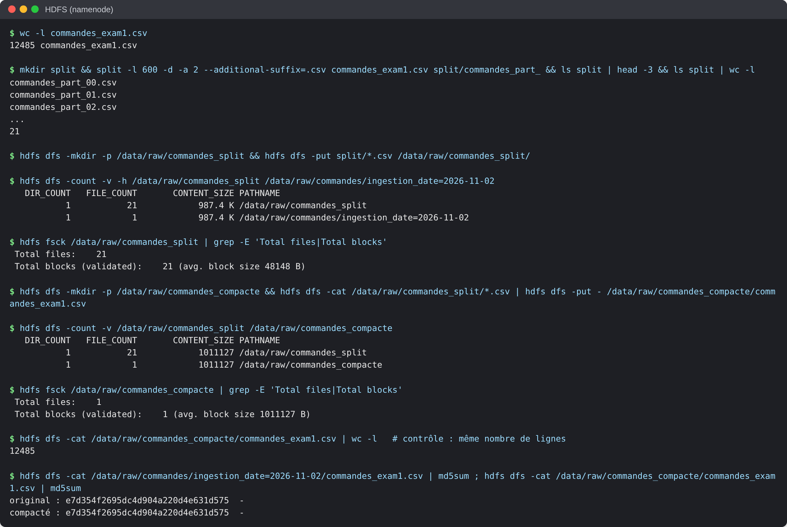

**Comment lire `hdfs dfs -count`** : les colonnes sont `DIR_COUNT` (répertoires), `FILE_COUNT` (fichiers),
`CONTENT_SIZE` (octets) et le chemin. Même volume, 21 fois plus de fichiers.

| | Fichiers | Blocs | Objets NameNode | Taille |
|---|---|---|---|---|
| 21 fichiers de 600 lignes (12 485 lignes ÷ 600 = 20,8, donc 21) | 21 | 21 (48 Ko en moyenne) | 42 | 1 011 127 o |
| après compaction | 1 | 1 | 2 | 1 011 127 o |

Le contenu est identique (même nombre de lignes, **même empreinte md5**), mais coûte **21 fois plus d'objets** au
NameNode. C'est exactement le problème de C1, en miniature. Seul le premier morceau contient l'en-tête CSV ; la
compaction par concaténation dans l'ordre le retrouve en tête.

Après la partie D, les zones `curated`, `rejects` et `analytics` ont été alimentées avec les fichiers Parquet produits
par Spark, à raison d'**un fichier par sortie** :

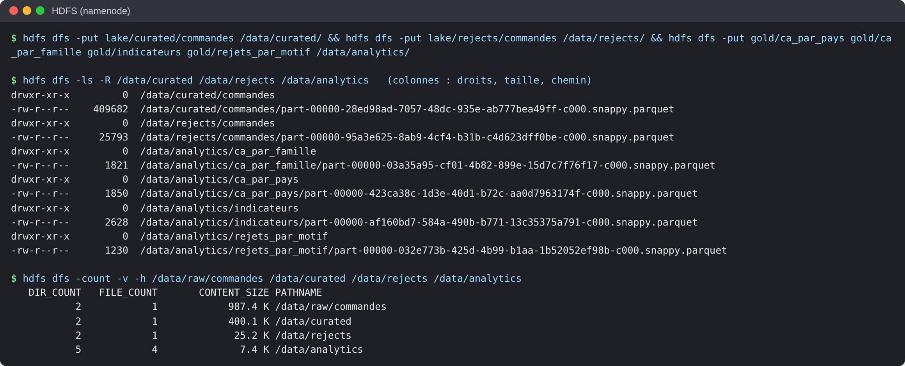

## C3. Déposer Kafka vers HDFS sans petits fichiers

1. Utiliser un connecteur qui **accumule** avant d'écrire (Kafka Connect HDFS Sink, ou sink fichier de Flink / Spark
   Structured Streaming), plutôt que d'écrire chaque message ou chaque minute.
2. Fermer un fichier **à la taille** (128 Mo à 1 Go) **ou au temps** (toutes les heures), à la première des deux
   limites atteinte.
3. Partitionner par **date et heure** (`ingestion_date=…/heure=…`), pas par entrepôt : l'entrepôt reste une colonne.
4. Écrire en format colonne compressé (Parquet ou Avro + Snappy), ce qui réduit aussi le volume.
5. Lancer chaque nuit une **compaction** de la partition de la veille pour fusionner les fichiers trop petits. Kafka
   (rétention 3 jours) sert de tampon en cas de retard.

# Partie D : Spark

Notebook : `spark/TP1_spark_D_E.ipynb` (exécuté, sorties visibles).

**Choix de lecture.** Toutes les colonnes sont lues **en texte**, avec un schéma imposé. Si Spark devinait les types,
une date ou une quantité illisible deviendrait NULL **sans laisser de trace**, et on ne pourrait plus distinguer
« vide » de « invalide ». On convertit ensuite soi-même (`cast`, `to_timestamp`) et on compte les échecs.

## D1. Contrôle qualité (un seul `agg`)

```python
qualite = cmd.agg(
    F.count("*").alias("nb_lignes"),
    F.countDistinct("id_commande").alias("nb_id_commande_distincts"),
    (F.count("*") - F.countDistinct("id_commande")).alias("doublons_id_commande"),
    *[F.sum(F.col(c).isNull().cast("int")).alias(f"null_{c}") for c in COLONNES],
    F.sum((F.col("quantite_i") <= 0).cast("int")).alias("quantite_<=0"),
    F.sum((F.col("ts_evenement").isNotNull() & F.col("ts_evt").isNull()).cast("int")).alias("dates_invalides"))
```

**Pourquoi un seul `agg` ?** Tous les indicateurs sont calculés en **une seule lecture** des données, au lieu d'un job
Spark par contrôle. Chaque condition devient 0 ou 1 (`cast("int")`), et `sum` compte les 1.

| Contrôle | Valeur | % des lignes | Comment c'est calculé |
|---|---|---|---|
| Nombre de lignes | 12 484 | 100 % | `count(*)` |
| `id_commande` distincts | 12 107 | 96,98 % | `countDistinct` |
| **Doublons sur `id_commande`** | **377** | 3,02 % | 12 484 − 12 107 : les lignes **en trop** |
| NULL `id_commande`, `id_entrepot`, `id_produit`, `quantite`, `ts_ingestion` | 0 | 0 % | |
| **NULL `pays`** | **190** | 1,52 % | champ vide dans le CSV |
| **NULL `prix_unitaire`** | **149** | 1,19 % | |
| NULL `ts_evenement` (date vide) | 12 | 0,10 % | |
| **Quantités ≤ 0** | **249** | 1,99 % | 0 ou négatives |
| **Dates invalides** | **88** | 0,70 % | renseignées mais illisibles : la conversion donne NULL alors que le texte ne l'était pas |

Exemples de dates invalides : `2026-02-30 08:12:00.000` (30 février), `2026-11-02 25:13:07.000` (25 h),
`02/11/2026 08:15` (mauvais format), `N/A`.

## D2. Pipeline propre

* **Dédoublonnage** sur `id_commande` : on garde la **première arrivée** (plus petit `ts_ingestion`), avec
  `row_number()` sur une fenêtre partitionnée par `id_commande` et triée par `ts_ingestion`. `dropDuplicates` garderait
  une copie **au hasard** ; trier rend le résultat reproductible. Les copies sont des renvois du producteur : mêmes
  valeurs, ingestion plus tardive.
* **Motif de rejet** : un seul motif par ligne, dans l'ordre de l'énoncé : `pays_absent`, puis `quantite_invalide`
  (≤ 0 ou illisible), `prix_absent`, `date_invalide` (vide ou illisible). L'ordre ne compte que pour les 7 commandes
  qui cumulent deux anomalies.
* **Écriture** en deux dossiers Parquet distincts : `lake/curated/commandes` et `lake/rejects/commandes` (avec motif et
  date de rejet). `coalesce(1)` écrit un seul fichier par sortie, pour ne pas fabriquer de petits fichiers (partie C).

**Preuve** (relecture des deux dossiers Parquet **écrits**, comparée au fichier brut) :

```
propres (11449) + rejets (658) = 12107
commandes distinctes                 = 12107
OK : propres + rejets = commandes distinctes
Aucune commande en double après dédoublonnage : True
```

| Motif | Rejets | Pourquoi ce chiffre diffère de D1 |
|---|---|---|
| quantite_invalide | 236 | 249 lignes en D1, mais certaines sont des copies (retirées par le dédoublonnage) ou ont déjà un pays absent |
| pays_absent | 186 | 190 lignes en D1, dont 4 copies : 186 commandes distinctes |
| prix_absent | 141 | idem |
| date_invalide | 95 | 88 invalides + 12 vides en D1, moins les copies et les cumuls |
| **Total** | **658** | |

## D3. Jointure et skew

**Pourquoi désactiver broadcast et AQE ?** Avec les réglages par défaut, Spark choisirait de lui-même la bonne stratégie
(vérifié plus bas). On les désactive pour **voir le problème** que l'on aurait entre deux grosses tables.

**Plan** (`explain`) : **SortMergeJoin** et **4 Exchange**.

```
SortMergeJoin [id_produit], [id_produit], Inner
:- Sort  +- Exchange hashpartitioning(id_produit, 200)      <- commandes redistribuées par produit
+- Sort  +- Exchange hashpartitioning(id_produit, 200)      <- produits redistribués par produit
HashAggregate(partial) puis Exchange hashpartitioning(famille, 200) puis HashAggregate(final)
Exchange rangepartitioning(ca DESC, 200)                    <- tri final (orderBy)
```

**Comment lire :** un **Exchange** est un **shuffle**, c'est-à-dire une redistribution des lignes entre machines par le
réseau, l'opération la plus coûteuse de Spark. Le SortMergeJoin redistribue **les deux côtés** par `id_produit` (toutes
les lignes d'un même produit doivent se retrouver dans la même tâche), les trie, puis les fusionne. Les deux autres
Exchange servent au `groupBy("famille")` et au tri. L'agrégation est faite en deux temps (`partial` puis `final`) : chaque
tâche pré-agrège avant le shuffle, comme dans Flink.

**Répartition par `id_produit`** : 40 produits ; **P007 (Webcam) représente 4 611 lignes, soit 40,3 % des commandes**,
alors qu'un produit en compte 286 en moyenne et 176 en médiane.

**Répartition par partition après `repartition('id_produit')`** : chaque ligne va dans la partition
`hash(id_produit) mod 200`. Toutes les lignes de P007 tombent donc dans **la même** partition.

* **38 partitions non vides sur 200** : il n'y a que 40 clés, et 2 paires de produits partagent une partition (collision
  de hash). Les 162 autres sont vides, donc autant de tâches pour rien.
* La plus grosse partition contient **4 611 lignes (40,3 %)**, soit **15,3 fois la moyenne** et **25,8 fois la médiane**
  des partitions non vides.

**Il y a donc un skew fort** : une seule tâche fait 40 % du travail pendant que les autres attendent. La durée d'une étape
est celle de sa tâche la plus lente.


## D4. Correction : broadcast join

**Principe.** La table produits fait **40 lignes (1,4 Ko)**. On l'**envoie en entier** à chaque tâche
(`F.broadcast(produits)`), et chaque tâche joint ses commandes avec sa copie locale. **Les commandes ne sont plus
redistribuées par `id_produit`** : elles restent dans leurs partitions d'origine, de taille équilibrée, donc le produit
majoritaire ne peut plus se concentrer dans une seule tâche.

**Mesures** sur une copie ×100 des commandes propres (1 144 900 lignes, même distribution) : à 11 449 lignes, toutes les
durées seraient de l'ordre de la milliseconde. Moyenne de 3 exécutions après échauffement ; métriques par tâche lues
dans l'API REST de Spark, sur l'étape qui exécute la jointure.

| | Avant (SortMergeJoin) | Après (broadcast) | Pourquoi |
|---|---|---|---|
| Type de jointure | SortMergeJoin | BroadcastHashJoin | |
| Exchange (shuffle) | 3 | 1 (+1 BroadcastExchange de 40 lignes) | il ne reste que le shuffle du `groupBy` |
| Lignes écrites en shuffle | 1 144 980 | 20 | 20 = 5 familles × 4 tâches de pré-agrégats |
| Tâches de l'étape de jointure | 200 (38 non vides) | 4 | une tâche par morceau de fichier lu |
| Lignes de la tâche la plus chargée | 461 101 | 286 226 | |
| Lignes de la tâche médiane | 17 851 | 286 225 | |
| **Déséquilibre max / médiane** | **25,8** | **1,0** | le skew a disparu |
| **Durée moyenne** | **1,45 s** | **0,73 s (÷ 2)** | |

Les deux versions donnent le même chiffre d'affaires par famille, à 0,00002 € près (arrondi des nombres flottants).

**Pourquoi le broadcast est la meilleure solution ici.**

* La table de dimension est minuscule (1,4 Ko, très en dessous du seuil de 10 Mo) : la diffuser ne coûte rien, et on
  supprime **toute** la redistribution des commandes. Le skew n'est pas compensé, il disparaît.
* Le **salting** ajoute un suffixe aléatoire (0 à N−1) à la clé majoritaire pour l'étaler sur N partitions, mais il
  faut alors **dupliquer N fois** la table produits et écrire plus de code. Il est utile quand les **deux** tables sont
  grosses, ce qui n'est pas le cas ici.
* L'**AQE** (`skewJoin`) ne découpe une partition que si elle dépasse **256 Mo et 5 fois la médiane** (valeurs par
  défaut vérifiées) : il ne se déclencherait pas à cette taille.
* Vérifié : avec les réglages **par défaut**, Spark choisit **de lui-même** le `BroadcastHashJoin`. Il estime la table
  produits à 1 425 octets, sous le seuil de 10 Mo ; l'AQE regroupe en plus les 200 partitions du `groupBy`
  (`AQEShuffleRead coalesced`).

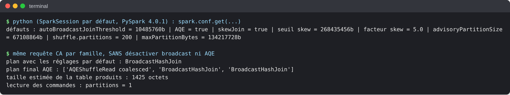

# Partie E : KPI et réconciliation

## E1. Couche gold (Parquet, dossier `gold/`)

**Pourquoi une couche gold ?** Ce sont des tables **petites, agrégées et prêtes à l'emploi** : la BI les lit en
quelques millisecondes sans recalculer 6 mois de commandes, et tout le monde utilise **la même** définition des
indicateurs.

**Chiffre d'affaires par pays** (`gold/ca_par_pays`). CA = Σ quantité × prix unitaire des commandes propres.

| Pays | CA (€) | Commandes | Panier moyen (€) | Part du CA |
|---|---|---|---|---|
| FR | 1 491 084,30 | 4 552 | 327,57 | 38,57 % |
| DE | 581 279,58 | 1 620 | 358,81 | 15,04 % |
| BE | 459 768,94 | 1 374 | 334,62 | 11,89 % |
| ES | 431 090,63 | 1 147 | 375,84 | 11,15 % |
| IT | 349 669,42 | 1 073 | 325,88 | 9,05 % |
| CH | 287 178,09 | 885 | 324,50 | 7,43 % |
| MA | 133 240,54 | 440 | 302,82 | 3,45 % |
| TN | 132 201,83 | 358 | 369,28 | 3,42 % |

**Chiffre d'affaires par famille** (`gold/ca_par_famille`, jointure avec les produits)

| Famille | CA (€) | Commandes | Quantité | Part du CA |
|---|---|---|---|---|
| Informatique | 1 880 673,93 | 5 852 | 18 198 | 48,65 % |
| Réseau | 748 150,97 | 829 | 2 546 | 19,35 % |
| Mobilier | 640 866,96 | 862 | 2 650 | 16,58 % |
| Outillage | 477 369,57 | 1 320 | 4 158 | 12,35 % |
| Consommables | 118 451,90 | 2 586 | 8 182 | 3,06 % |

Les commandes Informatique sont nombreuses (5 852) parce que la Webcam (P007), à elle seule 40 % des commandes, en fait
partie.

**Indicateurs** (`gold/indicateurs`) : **11 449 commandes propres** et 658 rejets sur 12 107 commandes distinctes, soit
un **taux de rejet de 5,43 %**. Le dénominateur est le nombre de commandes **distinctes** : un doublon n'est pas une
commande de plus, c'est un défaut de transport, suivi à part (taux de doublons 3,02 %). CA total : **3 865 513,33 €**.
Une table `gold/rejets_par_motif` complète le suivi qualité.

## E2. Réconciliation Flink / Spark

**Méthode.** On rejoue ligne par ligne, sur les données brutes (doublons compris), les règles du job Flink, puis on les
compare aux règles Spark :

* **compté par Flink** : quantité > 0, prix renseigné, date lisible (sans date, pas de fenêtre), et `ts_ingestion` ≤ fin
  de la minute + 5 s. Pas de dédoublonnage, pas de contrôle du pays.
* **compté par Spark** : première arrivée de la commande, et aucun motif de rejet.

Chaque ligne contribue `montant × (compté Flink − compté Spark)` à l'écart. Une ligne comptée d'un seul côté l'est pour
une seule raison, donc les causes ne se chevauchent pas et **leur somme retombe exactement sur l'écart**.

**Contrôle préalable.** Les règles rejouées redonnent exactement `ca_minute_flink.csv` : 120 minutes, 0 écart sur le
nombre de commandes comme sur le montant. Les règles sont donc bien comprises, et la décomposition repose sur un modèle
juste.

| | Lignes | Montant | % du CA Spark |
|---|---|---|---|
| CA Flink (somme des 120 minutes) | | **3 709 347,68 €** | |
| CA Spark (couche gold) | | **3 865 513,33 €** | |
| **Écart Flink − Spark** | | **−156 165,65 €** | **−4,04 %** |
| 1. doublons comptés par Flink | 295 | +96 432,79 € | +2,49 % |
| 2. pays absent compté par Flink | 166 | +54 915,40 € | +1,42 % |
| 3. événements tardifs ignorés par Flink (> 5 s après la fin de leur minute) | 824 | −307 513,84 € | −7,96 % |
| **Somme des causes** | | **−156 165,65 €** | **−4,04 %** |

**Pourquoi ces nombres de lignes, et pas ceux de D1 ?**

* **Doublons : 295 sur 377 copies.** Les 82 autres copies ne sont comptées par aucun des deux : 63 sont arrivées trop
  tard pour Flink, et 19 portent une anomalie (quantité, prix ou date) que Flink filtre aussi.
* **Pays absent : 166 sur 186.** 15 sont arrivées trop tard pour Flink, et 5 ont une autre anomalie qu'il filtre.
* **Tardifs : 824 commandes propres sur 11 449 (7,2 %)** arrivent plus de 5 s après la fin de leur minute. Spark les
  compte (il lit tout, après coup) ; Flink les avait déjà écartées.


**À retenir.** L'écart net (−4,04 %) **cache des écarts bruts presque trois fois plus gros** (+3,9 % et −8,0 %) qui se
compensent en partie. Selon les minutes, l'écart va de −10 555 € à +4 235 € : un écart global qui semble « acceptable »
peut masquer des minutes très fausses.


**Retard des événements ignorés** (temps entre la fin de leur minute et leur arrivée) : médiane 46 s, 90^e^ centile 86 s,
maximum 116 s. CA encore perdu selon le watermark : 7,96 % à 5 s, 5,60 % à 30 s, 2,75 % à 60 s, **0 % à 120 s**.

**Recommandation pour réduire l'écart**, par ordre d'effet :

1. **Événements tardifs (−7,96 %)** : garder un watermark court pour l'affichage temps réel, mais émettre des
   **corrections** (sortie en upsert par minute, ou recalcul de la minute à l'arrivée des retardataires). Sinon, pour
   les usages qui privilégient la complétude, un watermark de 120 s, qui couvre le retard maximal observé.
2. **Dédoublonner dans Flink (+2,49 %)** sur `id_commande` :
   `ROW_NUMBER() OVER (PARTITION BY id_commande ORDER BY proctime) = 1`, avec un TTL d'état de quelques heures pour ne
   pas garder tous les identifiants indéfiniment.
3. **Mêmes règles qualité dans les deux chemins (+1,42 %)** : pays obligatoire, écrit dans un contrat de données
   commun.
4. **Présenter Flink comme un chiffre provisoire**, Spark comme le chiffre officiel, avec un contrôle d'écart
   automatique chaque jour (cette réconciliation, industrialisée).

## E3. Restitution : option lake

Trois requêtes Spark SQL sur les tables gold (sorties dans le notebook) :

```sql
-- 1. Top 3 des pays et leur part du CA
SELECT pays, ca, nb_commandes, panier_moyen, part_ca_pct
FROM gold_ca_par_pays ORDER BY ca DESC LIMIT 3;
-- FR 1 491 084,30 € (38,57 %) ; DE 581 279,58 € (15,04 %) ; BE 459 768,94 € (11,89 %)

-- 2. Familles qui pèsent plus de 10 % du CA, avec le CA moyen par article vendu
SELECT famille, ca, part_ca_pct, ROUND(ca / quantite_totale, 2) AS ca_par_article
FROM gold_ca_par_famille WHERE part_ca_pct > 10 ORDER BY ca DESC;
-- Informatique, Réseau, Mobilier, Outillage (Consommables : 3,06 %, exclu)

-- 3. Tableau de bord qualité du jour
SELECT i.date_donnees, i.nb_commandes_propres, i.taux_rejet_pct,
       ROUND(100 * i.nb_doublons / i.nb_lignes_brutes, 2) AS taux_doublons_pct,
       m.motif_rejet AS motif_principal, m.part_des_rejets_pct
FROM gold_indicateurs i
CROSS JOIN (SELECT * FROM gold_rejets_par_motif ORDER BY nb_rejets DESC LIMIT 1) m;
-- 2026-11-02 | 11 449 | 5,43 % | 3,02 % | quantite_invalide | 35,87 %
```

Chaque requête répond à une question métier : où se fait le CA (1), quelles familles comptent (2), et peut-on faire
confiance aux données du jour (3). La troisième joint deux tables gold avec un `CROSS JOIN` : la table indicateurs
n'a qu'une ligne par jour, et la sous-requête ne garde que le motif principal.

**Dictionnaire de données (couche gold).**

| Table | Colonne | Définition | Règle de calcul |
|---|---|---|---|
| ca_par_pays | pays | pays de la commande (code ISO à 2 lettres) | valeur source, non nulle (sinon rejet) |
| ca_par_pays | ca | chiffre d'affaires en € | Σ quantite × prix_unitaire des commandes propres du pays |
| ca_par_pays | nb_commandes | nombre de commandes propres | COUNT(*) après dédoublonnage et rejets |
| ca_par_pays | panier_moyen | CA moyen par commande | ca / nb_commandes |
| ca_par_pays | part_ca_pct | poids du pays dans le CA | 100 × ca / CA total |
| ca_par_famille | famille | famille du produit | jointure `produits_exam1` sur id_produit |
| ca_par_famille | ca, nb_commandes, part_ca_pct | comme ci-dessus, par famille | idem |
| ca_par_famille | quantite_totale | articles vendus | Σ quantite |
| indicateurs | nb_lignes_brutes | lignes reçues | COUNT(*) du fichier brut |
| indicateurs | nb_doublons | lignes en double | lignes brutes − id_commande distincts |
| indicateurs | nb_commandes_distinctes | commandes uniques | COUNT(DISTINCT id_commande) |
| indicateurs | nb_commandes_propres / nb_rejets | commandes valides / rejetées | motif_rejet NULL / non NULL |
| indicateurs | taux_rejet_pct | part des commandes rejetées | 100 × nb_rejets / nb_commandes_distinctes |
| indicateurs | ca_total | CA officiel du jour | Σ quantite × prix_unitaire des commandes propres |
| rejets_par_motif | motif_rejet, nb_rejets, part_des_rejets_pct | répartition des rejets | COUNT par motif ; 100 × nb / total des rejets |

## E4. Définition du KPI « chiffre d'affaires »

**Pourquoi définir formellement ?** L'écart de E2 vient précisément de **deux définitions implicites différentes**. Un
KPI sans définition écrite donne autant de chiffres que d'équipes.

| Élément | Définition | Justification |
|---|---|---|
| Formule | CA = Σ (quantite × prix_unitaire), en euros (hypothèse : prix HT, hors remises et retours) | ce que contiennent les données |
| Inclusion | commandes **distinctes** (première arrivée conservée) avec pays, quantité > 0, prix et date valides ; rattachées à la date de **l'événement**, pas d'ingestion ; **retards inclus** | une commande passée à 08:59:58 et reçue à 09:00:40 appartient à 08:59 |
| Exclusion | doublons ; lignes rejetées, conservées dans `/data/rejects` avec leur motif et suivies par le taux de rejet ; annulations et retours (hors périmètre) | un doublon n'est pas une vente ; une ligne sans pays ne peut pas être ventilée |
| Source de vérité | **Spark, couche gold** ; Flink fournit un « CA temps réel **provisoire** » | Spark est complet, dédoublonné, contrôlé et rejouable |
| Fraîcheur attendue | temps réel : moins de 70 s (minute + watermark 5 s + écriture) ; officiel : J+1 avant 8 h | le temps réel sert à piloter, l'officiel à compter |
| Contrôle | réconciliation quotidienne Flink / Spark ; alerte si l'écart dépasse 1 % une fois les corrections E2 appliquées | un écart qui dérive signale un problème dans la chaîne |

# Partie F : synthèse

## Architecture de bout en bout

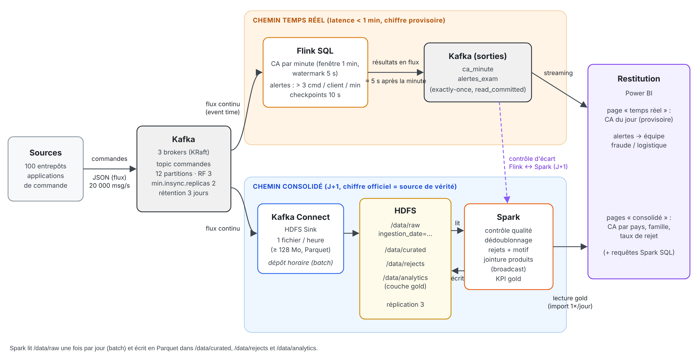{width=100%}

**Comment lire le schéma.** Il s'agit d'une architecture **Lambda** : un même flux Kafka alimente deux chemins.

* Le **chemin temps réel** (en haut) est rapide mais provisoire : Flink calcule à la volée, et ignore ce qui arrive trop
  tard.
* Le **chemin consolidé** (en bas) est lent mais complet : les données sont déposées dans HDFS par fichiers horaires,
  puis Spark les nettoie et produit la couche gold.
* Le **contrôle d'écart** (en violet) relie les deux chemins : c'est la réconciliation de E2, industrialisée.

Chaque flèche indique la nature du flux : flux continu, dépôt horaire en batch, lecture quotidienne, import BI.

## Trois risques de production et leur parade

| Risque | Conséquence | Parade |
|---|---|---|
| **Panne d'un broker ou d'un disque** | écritures bloquées (min.insync trop haut) ou perte de données (acks=1, élection d'une réplique en retard) | RF 3, min.insync.replicas 2, acks=all, idempotence, élection « unclean » désactivée, copies sur des baies différentes, alerte sur les partitions sous-répliquées (démontré en A2) |
| **Doublons et incohérences entre temps réel et consolidé** | KPI faux, décisions prises sur des chiffres qui divergent (démontré en B4 et E2) | Flink en exactly-once et lecteurs read_committed, dédoublonnage par id_commande dans les deux chemins, réconciliation automatique quotidienne |
| **Petits fichiers HDFS** | NameNode saturé (7,9 Go de métadonnées en 6 mois), jobs Spark lents (démontré en C) | dépôt par taille et par heure, partitionnement par date, compaction nocturne, suivi du nombre de fichiers |

## Une amélioration qui réduit l'écart temps réel / consolidé

**Faire passer les deux chemins par les mêmes données nettoyées.** Un job Flink « qualité » unique lit `commandes`,
dédoublonne sur `id_commande`, applique les règles de rejet, et écrit en exactly-once un topic `commandes_propres` (et
un topic `commandes_rejets`). Le calcul temps réel **et** le dépôt HDFS lisent ce même topic. Les écarts dus aux
doublons et au pays disparaissent par construction : +3,9 % ici.

Il ne reste alors que l'écart dû aux événements tardifs, qui est **normal** : le temps réel ne peut pas attendre ce qui
n'est pas encore arrivé. On le traite en écrivant les agrégats dans une table qui accepte les mises à jour (format
lakehouse Iceberg, Delta ou Paimon, ou topic en upsert) : chaque minute est corrigée quand ses retardataires arrivent,
et Spark comme Power BI lisent la même table. On se rapproche ainsi d'une architecture **Kappa**, avec un seul chemin
de traitement.
